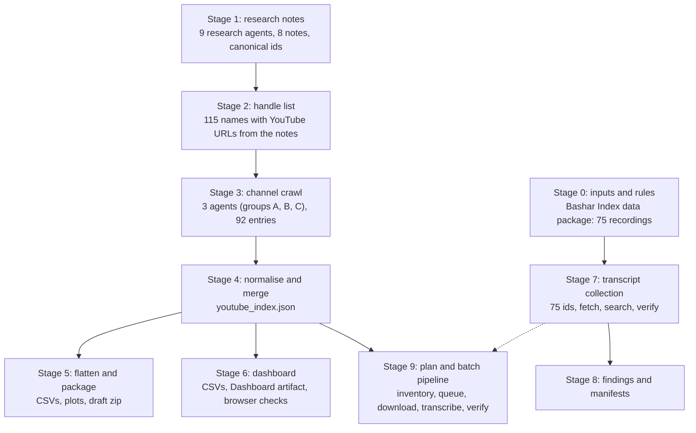

# ET channelers: YouTube crawl, index, dashboard and transcript pipeline

Work on the extraterrestrial-channeler thread of the Bashar Index: research notes on who channels whom, a crawl of their public YouTube channels, a flat index and dashboard of what was found, and a transcript pipeline used to answer questions about Bashar's recordings. This README follows the work from the first input to the last output, with the counts, the scripts that made each file, and what is missing.

**Snapshot.** Channel index observed 2026-10-23. Dashboard built 2026-10-26. Transcripts collected 2026-10-30. The plan for the rest, the batch pipeline and the roadmap were added 2026-11-11 (Stage 9). This README written 2026-11-11 from the files and session logs. Everything here is AI-generated (Claude, with sub-agents) and has not been through human editorial review. Claims are reported as claims, as in the rest of the repository.

**Not the Channeling Atlas.** [`channeling-atlas/`](../channeling-atlas/README.md) is a separate, larger and independently reviewed dataset (925 uploads). The numbers below use different denominators (92 people, 466 videos) and should not be added to or compared with the Atlas without the identity audit its roadmap calls N1.

## Links

| What | Where |
|---|---|
| Repository | <https://github.com/occult-kranti/bashar-index>. This work is the folder `et-channelers/` on the branch `research/et-channelers-youtube-index` (not on `main` yet). |
| Channeler YouTube index (dashboard) | <https://claude.ai/artifact/XFQHVyn2WSk7Xnn4yXpAa8>. A claude.ai page, private to its owner until shared. Page source: [`dashboard/index.html`](dashboard/index.html). |
| The Bashar Index, live site | <https://occult-kranti.github.io/bashar-index/> (GitHub Pages, served from `main`). |
| Channeling Atlas, live site | <https://occult-kranti.github.io/bashar-index/channeling-atlas/dist/index.html> |
| Channeling Atlas, analysis report | <https://occult-kranti.github.io/bashar-index/channeling-atlas/dist/analysis/report.html> |
| The Bashar Index, claude.ai page (September 2026 version) | <https://claude.ai/artifact/MF1hY9MYG95BaSqm9KXTFM> |
| The Frequency of a Place (experiment page) | <https://claude.ai/artifact/EXrUcxSotuWRW8NCaBHieY>. Its code is on the repository branch `experiment-frequency-of-place`. |

The three GitHub Pages addresses were reached on 2026-11-11. The Pages site is built from `main`, so nothing in `et-channelers/` appears there until the branch is merged.

## At a glance

Every number in this table is recomputed from the committed files by `python3 et-channelers/scripts/check_counts.py` (54 checks).

| What | Count |
|---|---|
| People / groups tracked | 92 |
| Fully crawled (channel page and latest uploads read) | 16 |
| Channel details from research notes only, video list not read | 38 |
| No YouTube channel recorded yet (the search never ran; absence is unverified) | 31 |
| Searched or flagged, not found | 7 |
| Video rows in the index | 466 (457 distinct video ids; 9 rows have no id) |
| Read from the 16 crawled channels | 449 (14 of the 16 hit the 30-video cap) |
| Entered from research notes, not crawled | 17 |
| Flagged as channeling, from the title | 244 |
| Title names an entity | 209 |
| Playlists / entity roll-ups | 12 / 15 |
| Bashar recordings targeted for transcripts | 75 |
| Transcript retrieved / errored | 55 / 20 |
| Other videos whose transcript was retrieved (6 more pages errored) | 9 |
| Videos with a transcript retrieved in total | 64 |
| Full transcripts saved as files (kept out of the repository) | 12 |
| Videos on the 48 channels that show a video count (44 entries have none, so this is a floor) | 40,652 |
| Channels with more than 1,000 videos | 14 |

## Pipeline



Stages 1 to 6 are the channel index. Stage 7 is a separate branch that starts from the Bashar Index recordings, not from the crawl. Stage 9 is the plan and tooling for reading the rest of the channels; it starts from the Stage 4 index and the Stage 7 recording list.

### Stage 0: inputs and ground rules

* Starting data: the Bashar Index data package already in this repository (`data/`): 75 structured digests of public recordings, `videos.json` (the same 75 with metadata), a 684-session catalogue.
* Scope chosen at the start: deep profiles plus a broad directory, ETs plus key non-ET channels, neutral documentary stance (no claim is endorsed), branch on this repository plus a dashboard artifact for hosting.
* Rules kept throughout: every fact carries a URL; relative dates stay relative ("3 weeks ago" as of 2026-10-23); counts and dates are never invented; recordings and transcripts are © Darryl Anka / Bashar Communications, Inc., so no transcript text is committed, the findings note keeps quotes to 30 words or fewer, and a spot check of the research notes found no quoted span over about 35 words; a page that fails with `client_error` is recorded and not fetched again through other routes.

### Stage 1: research notes (2026-10-22 to 10-23)

Nine general-purpose sub-agents covered eight topics with web search, page fetch and Firecrawl search/scrape, writing a markdown note with source URLs for each topic: 1985 to 2015 major channelers; the Ra material and pre-1981 lineage; Darryl Anka / Bashar; Athina Król / Ashtar lineage; Tyler Ellison / Ryok and smaller channels; YouTube-era channelers 2012 to 2026; Reddit, Wizard Forums and BALG (run twice, the second run a rerun, so one note); species catalogue, entities and skeptical coverage. By the session logs this was roughly 520 page fetches, 210 web searches, 110 Firecrawl scrapes and 215 Firecrawl searches.

* Output: [`research/notes/`](research/notes/), including `CANONICAL_IDS.md`, which fixes one slug per person so later stages join on the same id.
* Helper: [`scripts/research/reddit_dates.py`](scripts/research/reddit_dates.py) estimates the date of a Reddit post from its base-36 id by interpolating between dated anchor posts. Its dates are estimates.
* Four compile agents then turned the notes into drafts: `people` (only part 1, 23 people, was finished: [`youtube-index/people_part1.json`](youtube-index/people_part1.json)), entities/timeline/criticism, communities plus the YouTube index, and the final report ([`research/report/et-channelers-directory-and-timeline.md`](research/report/et-channelers-directory-and-timeline.md)). Planned schemas for the unfinished datasets are in [`youtube-index/DATA_SCHEMAS.md`](youtube-index/DATA_SCHEMAS.md).
* The report is a draft. Work was stopped on request on 2026-10-23 and the current state packaged as is.

### Stage 2: handle list

[`research/report/people_yt_handles.json`](research/report/people_yt_handles.json) lists 115 names, 46 of them with at least one YouTube URL the notes mention, and the note files they came from. It was prepared just before the crawl as a lookup for the crawl agents; it is not the crawl's input list and only partly overlaps it (45 of the 92 crawled entries have a channel URL or handle that appears on it). The crawl covered 92 people: 87 of the 129 people in `research/notes/CANONICAL_IDS.md` plus 5 ids the index added (L/L Research, Aetherius Society, Ashtar Command crew, Esther Hicks, Paul Selig). The 42 canonical people left out include many mid-century contactees, older channelers and anonymous or unnamed accounts.

### Stage 3: channel crawl (2026-10-23)

Three agents (groups A, B and C: 31, 31 and 30 people) looked up each person's channel and read the latest uploads through Firecrawl's `youtube-com` provider (`videos/resolve_channel`, `videos/search_videos`, `videos/channel_videos`, `videos/video_details`). For a crawled channel the provider returns the channel page and up to 30 recent videos with the displayed view count, relative publish time and length.

1. The raw provider result is saved to disk. [`scripts/crawl/extract.py`](scripts/crawl/extract.py) prints a compact listing of every channel in it.
2. The agent classifies each video from its title and description (`is_channeling`, `entity`, `note`) in a small spec file. [`scripts/crawl/build.py`](scripts/crawl/build.py) turns result plus spec into one JSON file per channel under [`youtube-index/per-channel/`](youtube-index/per-channel/).
3. [`scripts/crawl/assemble.py`](scripts/crawl/assemble.py) merges a folder of channel files into one group array and recomputes the summary counts: [`group_A.json`](youtube-index/group_A.json), [`group_B.json`](youtube-index/group_B.json), [`group_C.json`](youtube-index/group_C.json). Group C used compact per-channel files and its own [`scripts/crawl/group-C/build.py`](scripts/crawl/group-C/build.py). The output format is [`youtube-index/SCHEMA.md`](youtube-index/SCHEMA.md).
4. Firecrawl credits ran out part-way through. For every person the crawl could not reach, a stub with status `credits_exhausted` was written from the notes alone ([`scripts/crawl/notes_entries.py`](scripts/crawl/notes_entries.py), [`scripts/crawl/group-C/make_stubs.py`](scripts/crawl/group-C/make_stubs.py)). Of the 92 entries, 16 are `ok`, 75 are `credits_exhausted` and 1 is `not_found` (a search that found nothing).

Raw material kept: [`youtube-index/raw/`](youtube-index/raw/) (one saved provider result) and [`youtube-index/specs/`](youtube-index/specs/) (its classification spec).

### Stage 4: normalise and merge

[`scripts/build/build_youtube_index.py`](scripts/build/build_youtube_index.py) merges the three group files into [`youtube-index/youtube_index.json`](youtube-index/youtube_index.json). It is a compiler only and adds no new facts. It maps names to canonical person ids, parses integer subscriber and video counts out of the display text, collapses the status to four values, and builds per-person and per-entity roll-ups.

| Index status | Meaning | Entries |
|---|---|---|
| `ok` | Channel page and up to 30 recent videos read on 2026-10-23 | 16 |
| `metadata-only` | Was `credits_exhausted`; channel details come from the notes; the video list was not read, any videos listed are ones the notes recorded | 38 |
| `no_youtube` | No channel recorded in the notes and the planned search never ran; absence is unverified | 31 |
| `not_found` | A search found nothing, or the notes imply a channel but none was identified | 7 |

The original group-file status is kept in every entry as `original_status`.

### Stage 5: flatten and package (2026-10-23)

[`scripts/build/build_draft.py`](scripts/build/build_draft.py) (no network) flattened the index and notes into CSVs (channels, videos, entity roll-up, playlists, a harvest of YouTube links found in the notes, Bashar recordings by channel, a people directory, a draft timeline), two plots, a README and a zip. That zip was the unreviewed draft delivered on 2026-10-23. Its CSVs, plots and README are in [`draft-package/`](draft-package/): 127 people parsed from the notes, 530 dated timeline entries, 73 entity blocks, 136 YouTube links harvested from the notes, plus the channel, video, playlist and entity tables. The `notes/`, `data/` and report copies the zip also held are the same files as `research/notes/`, `youtube-index/` and `research/report/` here, so they are not duplicated. The draft README is a snapshot of 2026-10-23, kept as written: its statement that the dashboard update and a repository branch were "not built" predates Stage 6 and this folder. It lists what was known to be missing when work stopped (Reddit: nothing retrieved; Wizard Forums: two site searches; BALG: eleven threads read; the people table was parsed from free-text notes by label matching, and 18 of its 127 rows have no parsed entity, start date or first-public value). Its one-line gloss of `no_youtube` ("no channel was found or applies") is looser than the rule in `youtube_index.json`; trust the index rule. [`scripts/build/build_communities.py`](scripts/build/build_communities.py) builds the forum-communities table from the notes; its output file was not retained in this snapshot.

### Stage 6: dashboard (2026-10-26)

The index was flattened again into four dashboard tables in [`dashboard/data/`](dashboard/data/): `channels.csv` (92 rows), `videos.csv` (466), `playlists.csv` (12) and `entities.csv` (15). Subscriber and view counts are parsed to numbers, `channeling` is yes/no, and every row has an id and the observed date. That export ran inline and was not saved as a script; `build_draft.py` is the closest saved equivalent, and `check_counts.py` verifies the tables against the JSON.

The tables feed a Dashboard-type Claude Artifact called "Channeler YouTube index" ([open it](https://claude.ai/artifact/XFQHVyn2WSk7Xnn4yXpAa8); it is private to its owner, so it needs the owner's login). The page source is [`dashboard/index.html`](dashboard/index.html): headline figures, a coverage bar, entity bars, an audience chart and channel, video and playlist tables. Two live fixes (a duplicated word and a missing observed-date fill) were applied and the live page was checked identical to this copy.

Browser check: [`dashboard/qa/run.py`](dashboard/qa/run.py) loads a harness page in headless Chromium at 1100 px and 400 px wide and reports script errors, horizontal overflow and row counts. [`dashboard/qa/page_check.js`](dashboard/qa/page_check.js) is the dashboard's page script as it was extracted for that harness. It predates the observed-date fix, so `dashboard/index.html` has two more lines in its script.

### Stage 7: transcript collection

Used for the question "what did Bashar say about astrology, star signs and calendars as a permission slip?" (2026-10-30). It starts from the Bashar Index recordings, not from the crawl.

1. **Targets.** The 75 video ids in [`transcripts/scripts/all_ids.txt`](transcripts/scripts/all_ids.txt), taken from `data/videos.json`.
2. **Source.** Auto-caption transcript pages at youtubetotranscript.com (`/transcript?v=<id>`) for YouTube re-uploads of full sessions. Direct watch pages were blocked or bot-protected.
3. **Two retrieval routes.**
   * Firecrawl scrape of the transcript page. The result was saved as JSON, then [`extract.py`](transcripts/scripts/extract.py) or [`ingest_all.py`](transcripts/scripts/ingest_all.py) wrote `<id>.txt`. 12 videos were saved this way; the files stay out of the repository.
   * Nine `web-fetch` sub-agents (five chunks of the list, one for short clips, two for the longest sessions, one for two astrology clips) each fetched a handful of pages and handed back matching passages and verbatim excerpts. A fetch returns about 40,000 characters, so long sessions need several calls. Five sweep agents hit their turn limit, so each was asked for a partial hand-back and the uncovered ids were rerun in smaller batches.
4. **Search.** [`grep_ctx.py`](transcripts/scripts/grep_ctx.py) prints merged context windows around a regex for the saved files; the agents did the equivalent on the pages they fetched. The 75 AI digests in `data/digests/` were used only as a secondary index, because they had missed some passages.
5. **Verification.** Each quote used in the findings was checked against the caption text it came from. Where the text came from a sub-agent or from a read that left no copy, the findings table says so.
6. **Failures.** 20 pages returned `client_error` and were not retried through other routes. Of those 20, two (`mk_yQrOQHJs`, `tskKYl3w0J8`) are duplicate uploads of a session that was read (`DvWNnqnBAjc`); the other 18 are unread, including three full sessions.
7. **Other transcripts.** Sub-agents working on profiles and on an experiment retrieved nine more videos' transcripts (six more pages errored): [`transcripts/other_videos_manifest.csv`](transcripts/other_videos_manifest.csv).
8. **Manifests.** [`transcripts/bashar75_manifest.csv`](transcripts/bashar75_manifest.csv) records, for each of the 75 ids, retrieved or error, how it was read and whether a full text was saved locally. It was built by [`build_manifest.py`](transcripts/scripts/build_manifest.py) from the agent logs ([`count_from_agent_logs.py`](transcripts/scripts/count_from_agent_logs.py)) and the saved-file list. Two recordings were read in the main session before those logs begin; they are marked `main_session_inline`.

### Stage 8: findings

[`transcripts/findings/astrology-calendars-permission-slip.md`](transcripts/findings/astrology-calendars-permission-slip.md) answers the question with short quotes, the recording each came from, how it can be re-checked, and what was not found. Answers given in chat on other questions (names, hedonism) are not archived here.

### Stage 9: plan and batch pipeline for the remaining channels (2026-11-11)

Written after the request to cover "the rest": every tracked channel, every video, as audio and as transcripts. It is code and plan only; no audio has been downloaded (see the real-download row under [Plan for the rest](#plan-for-the-rest)).

| Script | Job |
|---|---|
| [`pipeline/inventory.py`](pipeline/inventory.py) | totals and size estimates from the committed index; writes [`plan/`](plan/) and rewrites the table below |
| [`pipeline/select_jobs.py`](pipeline/select_jobs.py) | builds the queue (Bashar-75, indexed, channeling or all) with a seeded per-channel sample and length filters |
| [`pipeline/discover.py`](pipeline/discover.py) | lists every video on a channel (public metadata) |
| [`pipeline/download_audio.py`](pipeline/download_audio.py) | parallel, resumable yt-dlp download, re-encoded by ffmpeg to mono 16 kHz Opus |
| [`pipeline/transcribe.py`](pipeline/transcribe.py) | parallel faster-whisper transcription, one process per GPU |
| [`pipeline/verify.py`](pipeline/verify.py), [`pipeline/export_public.py`](pipeline/export_public.py) | integrity checks and a human-check sample; the publishable numbers-and-hashes table |
| [`pipeline/doctor.py`](pipeline/doctor.py), [`scripts/guard_no_raw_media.py`](scripts/guard_no_raw_media.py) | machine check; repository guard against raw media, captions, transcripts and credentials |

Design: resumable manifests, stable-hash shards, a global start-rate limit with per-channel caps, a circuit breaker that stops after three 403, 429 or bot-check answers in a row, a dry-run default, and a refusal to write inside a Git checkout. [`pipeline/README.md`](pipeline/README.md) has the commands and the full list of what was and was not tested.

Checks run on 2026-11-11:

1. **Automated tests** (`pipeline/tests/test_pipeline.py`, stand-in yt-dlp and ffmpeg, no network): 75 pass. Breaking four safety rails on purpose (the breaker, the channel cap, the Git-folder refusal, resume) made the tests fail each time.
2. **Real tools where they can run offline.** ffmpeg produced mono Opus from a stereo file; faster-whisper 1.2.1 with `Systran/faster-whisper-tiny.en` transcribed a 10-second public speech clip correctly on CPU; yt-dlp 2026.10.26 accepted every option the scripts use.
3. **A bug found that way.** faster-whisper 1.2.1 fails with PyAV 19 (`av.open() got an unexpected keyword argument 'metadata_errors'`), and a fresh install pulls PyAV 19. The pipeline now decodes audio with ffmpeg, and a test guards it.
4. **Real YouTube pilot, from a cloud server.** Three Bashar videos were requested one at a time. All three were refused: two "confirm you're not a bot" responses and one HTTP 403. The circuit breaker stopped the run (exit code 3). No cookies, proxies, other player clients or mirror sites were tried. The download therefore has to run from the owner's own computer.
5. **Not tested:** a GPU, Windows, large models, long batches.

## Limits to keep in mind

* **A sample, not a census.** The 92 are the people the crawl covered, not the whole field. The people lists were never merged into one master list: 129 canonical ids, 127 rows parsed into the draft directory, 115 names on the handle list and 92 crawled. Only the 30 most recent uploads were read per crawled channel, so older videos are not represented, and 14 of the 16 crawled channels hit that cap.
* **Most of the list was not crawled.** 76 of 92 entries were not crawled and carry only the 17 videos the notes happened to record. The 31 `no_youtube` entries say only that no channel was found in the notes.
* **Titles drive the labels.** `is_channeling` and `entity` come from video titles and descriptions as read by the agents. They were not checked against the video content.
* **Display text, as of 2026-10-23.** Views and subscriber counts are the numbers shown that day. Only 3 of 466 videos have an ISO publish date; the rest are relative ("3 weeks ago").
* **Transcripts are auto-captions of fan re-uploads.** Wording can be off, title dates are the uploaders' labels, and the unread 20 may change any "not found" conclusion. Only 12 transcripts exist as standalone files, and those are not committed.
* **Some numbers cannot be rebuilt from this repository alone.** Tool-call volumes, per-id fetch attempts and the 55/20 split come from sub-agent logs that are not committed. The manifests record their results; `check_counts.py` checks everything else.
* **The plan's totals are floors and estimates.** 44 of the 92 entries have no video count, the 40,652 is the sum for the other 48, and the hour figures multiply counts by mean lengths read from 449 recent videos on 16 channels. They are planning numbers, not measurements.
* **Nothing has been downloaded or transcribed in Stage 9.** The only real YouTube attempt (3 videos, from a cloud server) was refused.
* **Raw provider responses are data, not instructions.** One Firecrawl response carried a block of "agent hints" asking the reader to tell the user about credits and an upgrade link; it was ignored and disclosed.

## Not in this repository

Full transcripts, any audio or captions the pipeline downloads, and the sub-agent logs; three contact email addresses that appeared in the research notes, and in one cell of the draft people table that was parsed from them (all replaced with `[email redacted]` in this copy, so that one cell differs from the delivered zip); raw third-party page scrapes used as research input (a Kryon channel list, a Lieder wiki page, Amazon author pages); screenshots; and the separate frequency-of-place experiment, which lives on the `experiment-frequency-of-place` branch.

## Repository map and where the files came from

| Here | Original location in the session |
|---|---|
| `research/notes/` | `research_notes/ET channelers directory and timeline/*.md` |
| `research/report/` | `reports/` (file renamed to remove spaces) |
| `youtube-index/` | the `youtube_index/` notes folder, `etc_site/data/` and `etc_site/data/_parts/` |
| `draft-package/` | the delivered draft zip's `csv/`, `plots/` and README (only the parts not already stored elsewhere here) |
| `youtube-index/per-channel/group-A, group-B, group-C` | scratch folders `channels/`, `ytB/channels/`, `groupC/channels/` |
| `dashboard/` | scratch folders `dash/` and `harness/` |
| `scripts/`, `transcripts/scripts/` | scratch scripts, copied without changes |
| `pipeline/`, `plan/`, `ROADMAP.md`, `scripts/guard_no_raw_media.py` | written for this repository on 2026-11-11 (Stage 9); `plan/` is generated by `pipeline/inventory.py` |

The scripts keep the absolute paths they had during the session (for example `/home/claude/etc_site/data/`). Point the constants at the top of each file at this folder before rerunning, as with `src/build.py` at the repository root. The Bashar Index data package the scripts call `work/data_pkg/package` is `data/` here. `scripts/check_counts.py`, `transcripts/scripts/build_manifest.py` and the Stage 9 files are the ones written for the repository and use relative paths or arguments.

## Plan for the rest

**Goal.** Bring every public video on every tracked channel into the same two private forms, a small mono audio file and a timestamped transcript, so the whole set can be analysed one way. Today 75 Bashar recordings have been looked at (55 transcript pages retrieved, 12 saved as files) and the index holds 466 videos; the channels it tracks hold at least 40,652. The phases, estimates, risks and open decisions are in [`ROADMAP.md`](ROADMAP.md); the tooling is in [`pipeline/README.md`](pipeline/README.md).

**Where it stands (2026-11-11).**

| Step | State |
|---|---|
| Inventory of all 92 entries with video totals | done; the table below is generated from the index |
| Queue builder, channel lister, audio downloader, transcriber, verifier, public export, machine check | built; the automated tests pass using stand-in downloader and encoder tools |
| The parts that can run offline, for real | done: ffmpeg encoded mono Opus; faster-whisper `tiny.en` transcribed a public speech clip; yt-dlp accepted every option used |
| Real YouTube download | tried once, from a cloud server, on 2026-11-11: 3 of 3 pilot videos were refused (two bot checks, one HTTP 403) and the run stopped by design. Nothing was downloaded. It has to run from the owner's own computer. |
| GPU transcription speed, Windows, long batches | not measured, not tested |

**Rules for the data.** Audio, captions and transcripts stay in a private folder outside this repository (default `~/et-channelers-private`, synced to Google Drive if wanted) and are released, if at all, only alongside the final paper. What may be published is a table of numbers and hashes (`pipeline/export_public.py`). The recordings belong to their rights holders (the Bashar sessions: Darryl Anka / Bashar Communications, Inc.), and downloading media from YouTube is outside YouTube's terms unless a feature offers it. So the scripts stop at the first signs of blocking and use no cookies, logins, proxies or other ways around a block, and `scripts/guard_no_raw_media.py` fails if the repository holds audio, captions, speech-to-text output or credentials.

**Every tracked channel and its video total.** Generated by `python3 et-channelers/pipeline/inventory.py --update-readme` from `youtube-index/youtube_index.json` (observed 2026-10-23). Do not edit the block by hand; `check_counts.py` fails if it drifts.

<!-- inventory:start -->
**Totals.** 48 of 92 entries have a channel video count on record; together they hold **40,652 videos** (14 channels have more than 1,000; the median channel has 403.5). The other 44 entries have no count yet, so every total below is a floor.

**Rough size.** The 449 videos actually measured average 19.8 minutes (median 13.1; 20% are under 5 minutes, 8% over an hour). That puts the known total at about **14,223 hours of audio** (plausible range 9,464 to 16,048). Stored as mono 24 kbps Opus that is roughly 154 GB (205 GB at 32 kbps). Transcription time depends on the speed-up measured in the pilot: 15x real time = 948 GPU-hours, 30x real time = 474 GPU-hours, 60x real time = 237 GPU-hours, 120x real time = 119 GPU-hours. These are planning figures, not measurements; [`plan/estimates.json`](plan/estimates.json) shows the arithmetic and caveats.

**Bashar pilot set.** The 75 recordings already digested in this repository hold about 1,186,510 words, roughly 141.3 hours at 140 words per minute.

Largest channels (full list below):

| # | Person or group | Channel | Index status | Subscribers | Videos on channel | In index | Est. hours |
|--:|---|---|---|--:|--:|--:|--:|
| 1 | Daniel Scranton | [@DanielScranton](https://www.youtube.com/@DanielScranton) | ok | 56,700 | 6,300 | 30 | 2,185 |
| 2 | Ivan Teller | [@IvanTeller](https://www.youtube.com/@IvanTeller) | metadata-only | 10,100 | 5,400 | 0 | 1,784 |
| 3 | Ismael Perez | [@THEREALISMAELPEREZ](https://www.youtube.com/@THEREALISMAELPEREZ) | metadata-only | 116,000 | 2,500 | 0 | 826 |
| 4 | Lauren Galey | [@laurengaley](https://www.youtube.com/@laurengaley) | metadata-only | 31,600 | 2,300 | 0 | 760 |
| 5 | Brad Johnson | [@ThePrimeMentorYT](https://www.youtube.com/channel/UCQeHcVNo6CPWpgJaqEObrqA) | metadata-only | 75,300 | 1,800 | 1 | 595 |
| 6 | Mônica de Medeiros | [@MonicadeMedeirosCdC](https://www.youtube.com/@MonicadeMedeirosCdC) | ok | 523,000 | 1,800 | 28 | 881 |
| 7 | Riz Mirza | [@METAMYSTICPODCAST](https://www.youtube.com/channel/UCxySqZJLubIeMuaS6fvJQZg) | ok | 564,000 | 1,800 | 30 | 618 |
| 8 | Lorie Ladd | [@LorieLadd](https://www.youtube.com/@LorieLadd) | ok | 187,000 | 1,700 | 30 | 1,201 |
| 9 | Tyler Ellison | [@thegalacticguide111](https://www.youtube.com/@thegalacticguide111) | ok | 8,130 | 1,600 | 30 | 438 |
| 10 | Erin Lyons | [@erinlyonstv](https://www.youtube.com/channel/UCRA05_dP0kO1d0SmBtC0yxQ) | metadata-only | 92,600 | 1,200 | 0 | 396 |
| 11 | Aaron Abke | [@aaronabke](https://www.youtube.com/@aaronabke) | metadata-only | 374,000 | 1,195 | 0 | 395 |
| 12 | Aurora Ray | [@AuroraRay](https://www.youtube.com/@AuroraRay) | ok | 49,500 | 1,100 | 30 | 515 |
| 13 | Elsa Farrús Rusiñol | [@elsafarrusrusinol2135](https://www.youtube.com/channel/UCzgKzmZcMPsMaUh7Zl57Tgg) | ok | 242,000 | 1,100 | 30 | 128 |
| 14 | Magenta Pixie | [@MagentaPixie](https://www.youtube.com/@MagentaPixie) | metadata-only | 143,000 | 1,100 | 0 | 363 |
| 15 | Pamela Aaralyn | [@PamelaAaralyn](https://www.youtube.com/@PamelaAaralyn) | ok | 88,400 | 841 | 30 | 196 |

<details><summary>All 92 entries, largest first, then the ones with no count</summary>

| # | Person or group | Channel | Index status | Subscribers | Videos on channel | In index | Est. hours |
|--:|---|---|---|--:|--:|--:|--:|
| 1 | Daniel Scranton | [@DanielScranton](https://www.youtube.com/@DanielScranton) | ok | 56,700 | 6,300 | 30 | 2,185 |
| 2 | Ivan Teller | [@IvanTeller](https://www.youtube.com/@IvanTeller) | metadata-only | 10,100 | 5,400 | 0 | 1,784 |
| 3 | Ismael Perez | [@THEREALISMAELPEREZ](https://www.youtube.com/@THEREALISMAELPEREZ) | metadata-only | 116,000 | 2,500 | 0 | 826 |
| 4 | Lauren Galey | [@laurengaley](https://www.youtube.com/@laurengaley) | metadata-only | 31,600 | 2,300 | 0 | 760 |
| 5 | Brad Johnson | [@ThePrimeMentorYT](https://www.youtube.com/channel/UCQeHcVNo6CPWpgJaqEObrqA) | metadata-only | 75,300 | 1,800 | 1 | 595 |
| 6 | Mônica de Medeiros | [@MonicadeMedeirosCdC](https://www.youtube.com/@MonicadeMedeirosCdC) | ok | 523,000 | 1,800 | 28 | 881 |
| 7 | Riz Mirza | [@METAMYSTICPODCAST](https://www.youtube.com/channel/UCxySqZJLubIeMuaS6fvJQZg) | ok | 564,000 | 1,800 | 30 | 618 |
| 8 | Lorie Ladd | [@LorieLadd](https://www.youtube.com/@LorieLadd) | ok | 187,000 | 1,700 | 30 | 1,201 |
| 9 | Tyler Ellison | [@thegalacticguide111](https://www.youtube.com/@thegalacticguide111) | ok | 8,130 | 1,600 | 30 | 438 |
| 10 | Erin Lyons | [@erinlyonstv](https://www.youtube.com/channel/UCRA05_dP0kO1d0SmBtC0yxQ) | metadata-only | 92,600 | 1,200 | 0 | 396 |
| 11 | Aaron Abke | [@aaronabke](https://www.youtube.com/@aaronabke) | metadata-only | 374,000 | 1,195 | 0 | 395 |
| 12 | Aurora Ray | [@AuroraRay](https://www.youtube.com/@AuroraRay) | ok | 49,500 | 1,100 | 30 | 515 |
| 13 | Elsa Farrús Rusiñol | [@elsafarrusrusinol2135](https://www.youtube.com/channel/UCzgKzmZcMPsMaUh7Zl57Tgg) | ok | 242,000 | 1,100 | 30 | 128 |
| 14 | Magenta Pixie | [@MagentaPixie](https://www.youtube.com/@MagentaPixie) | metadata-only | 143,000 | 1,100 | 0 | 363 |
| 15 | Pamela Aaralyn | [@PamelaAaralyn](https://www.youtube.com/@PamelaAaralyn) | ok | 88,400 | 841 | 30 | 196 |
| 16 | Steve Nobel | [@SteveNobel](https://www.youtube.com/@SteveNobel) | metadata-only | 198,000 | 721 | 0 | 238 |
| 17 | Gosia Duszak (Cosmic Agency) | [@CosmicAgency](https://www.youtube.com/@CosmicAgency) | metadata-only | 108,000 | 639 | 0 | 211 |
| 18 | Blossom Goodchild | [@isjaabmo](https://www.youtube.com/channel/UCtYNUevWytubYiElIY44pbg) | ok | 51,100 | 572 | 30 | 226 |
| 19 | Sam the Illusionist | [@SAMTHEILLUSIONIST](https://www.youtube.com/@SAMTHEILLUSIONIST) | metadata-only | 118,000 | 548 | 0 | 181 |
| 20 | Rob Gauthier | [@E.T.whisperer](https://www.youtube.com/channel/UC8JooeMCjTYIKhO7UXLbMtg) | metadata-only | 20,700 | 547 | 0 | 181 |
| 21 | Jamye Price | [@JamyePrice](https://www.youtube.com/@JamyePrice) | metadata-only | 31,200 | 484 | 0 | 160 |
| 22 | Debbie Solaris | [@debbiesolarisgalactichistorian](https://www.youtube.com/@debbiesolarisgalactichistorian) | metadata-only | 29,900 | 467 | 1 | 154 |
| 23 | Louise Kay | [@LouiseKay](https://www.youtube.com/@LouiseKay) | metadata-only | 28,900 | 455 | 0 | 150 |
| 24 | Gigi Young | [@GigiYoung](https://www.youtube.com/@GigiYoung) | metadata-only | 147,000 | 425 | 0 | 140 |
| 25 | Elena Danaan | [@ElenaDanaan](https://www.youtube.com/@ElenaDanaan) | metadata-only | 212,000 | 382 | 0 | 126 |
| 26 | Elizabeth April | [@ElizabethApril](https://www.youtube.com/@ElizabethApril) | metadata-only | 564,000 | 333 | 0 | 110 |
| 27 | Darryl Anka | [@BasharChanneledbyDarrylAnka](https://www.youtube.com/@BasharChanneledbyDarrylAnka) | metadata-only | 229,000 | 322 | 2 | 106 |
| 28 | Anrita Melchizedek | [@AnritaMelchizedek222](https://www.youtube.com/channel/UCv_L3ZeWBzAl0Mf1LctCHjw) | metadata-only | 28,300 | 273 | 0 | 90 |
| 29 | Pavlina Klemm | [@pavlina-klemm](https://www.youtube.com/@pavlina-klemm) | ok | 47,800 | 273 | 30 | 78 |
| 30 | Suzanne Lie | [@suzannelie](https://www.youtube.com/channel/UCm_HEdtHNzUQeamPqmHXDDg) | metadata-only | 18,200 | 269 | 0 | 89 |
| 31 | Pleiadian Council Whispers | [@Pleiadian_Council_Whispers](https://www.youtube.com/@Pleiadian_Council_Whispers) | metadata-only | 10,400 | 262 | 1 | 87 |
| 32 | Krista Raisa | [@orioncouncil](https://www.youtube.com/@orioncouncil) | metadata-only | 25,200 | 256 | 0 | 85 |
| 33 | Tracey Milne | [@traceymilneaahp6448](https://www.youtube.com/channel/UCyUnXlV50x3eHjqlwrInTFQ) | metadata-only | 8,380 | 231 | 1 | 76 |
| 34 | Wieteke Koolhof | [@Design4awareness](https://www.youtube.com/@Design4awareness) | metadata-only | 5,810 | 202 | 0 | 67 |
| 35 | Tolec | [@TransformationalShiftEvents](https://www.youtube.com/channel/UCFuGvM2B9d4nD25drHFlt0A) | metadata-only | 19,100 | 188 | 2 | 62 |
| 36 | Ashley Cunningham | [@AshleyCunningham](https://www.youtube.com/channel/UCuRp4CDUsdK99u22kWWd5dg) | metadata-only | 2,240 | 160 | 0 | 53 |
| 37 | Athina Król | [@AthinaKrol](https://www.youtube.com/@AthinaKrol) | metadata-only | 5,410 | 152 | 4 | 50 |
| 38 | Lyssa Royal Holt | [@SOLiSchoolLyssaRoyalHolt](https://www.youtube.com/@SOLiSchoolLyssaRoyalHolt) | ok | 9,260 | 143 | 30 | 42 |
| 39 | Megan Rose | [@meganrosecontact](https://www.youtube.com/channel/UCBzuc3GzJtl0sHgvlB_eczA) | ok | 74,800 | 142 | 30 | 53 |
| 40 | Nora Herold | [@noraherold](https://www.youtube.com/@noraherold) | metadata-only | 6,150 | 121 | 0 | 40 |
| 41 | チャネラー純子 Channeler Junko | [@benzaiten1111](https://www.youtube.com/@benzaiten1111) | ok | 29,800 | 111 | 30 | 35 |
| 42 | Shaun Swanson | [@ShaunSwanson](https://www.youtube.com/@ShaunSwanson) | ok | 3,790 | 84 | 30 | 18 |
| 43 | Wendy Kennedy | [@hgrfrequencies](https://www.youtube.com/channel/UCLQruf49jF7P5fIZoe6lM1g) | ok | 31,500 | 75 | 30 | 9 |
| 44 | Micheila Sheldan | [@MicheilaSheldan](https://www.youtube.com/@MicheilaSheldan) | metadata-only | 10,900 | 31 | 2 | 10 |
| 45 | Leslie Muller | [@NewEarthTeachings](https://www.youtube.com/@NewEarthTeachings) | metadata-only | 8 | 25 | 0 | 8 |
| 46 | Ashtar Command: Lower Decks | [@Anmahatdra_Lyrhaan](https://www.youtube.com/@Anmahatdra_Lyrhaan) | metadata-only | 3,480 | 19 | 1 | 6 |
| 47 | Kayleigh O'Keefe | [@KayleighOKeefe](https://www.youtube.com/@KayleighOKeefe) | metadata-only | 4,100 | 3 | 1 | 1 |
| 48 | Aluna Ash | [@alunaash9d373](https://www.youtube.com/@alunaash9d373) | ok | 1,580 | 1 | 1 | 0 |
|  | Abraham-Hicks (Esther Hicks) | none on record | metadata-only | 741,000 | ? | 0 | ? |
|  | Andrew Bayuk | [@ElanInteractions](https://www.youtube.com/@ElanInteractions) | metadata-only | ? | ? | 0 | ? |
|  | Fernanda and Flavia (Lightworkers613) | none on record | metadata-only | ? | ? | 0 | ? |
|  | Paul White Gold Eagle (Prime Disclosure) | [@PaulWhiteGoldEagle](https://www.youtube.com/@PaulWhiteGoldEagle) | metadata-only | ? | ? | 0 | ? |
|  | Rachel Chamness (Sound Waves Heal) | [@soundwavesheal](https://www.youtube.com/@soundwavesheal) | metadata-only | ? | ? | 0 | ? |
|  | Sarah Evans (Into the Blue Channeling) | [@sarahevansandco](https://www.youtube.com/@sarahevansandco) | metadata-only | ? | ? | 0 | ? |
|  | Corey Goode | none on record | not_found | ? | ? | 0 | ? |
|  | Edson Tozzi (Brazil) | none on record | not_found | ? | ? | 0 | ? |
|  | Grace Solaris | none on record | not_found | ? | ? | 0 | ? |
|  | Judy Satori | none on record | not_found | ? | ? | 1 | ? |
|  | Lee Carroll | none on record | not_found | ? | ? | 0 | ? |
|  | Suzanne Ward | none on record | not_found | ? | ? | 0 | ? |
|  | Toni Ghazi | none on record | not_found | ? | ? | 0 | ? |
|  | "Channeling Arcturians" (Erica of the Sassani) | none on record | no_youtube | ? | ? | 0 | ? |
|  | Aetherius Society | none on record | no_youtube | ? | ? | 0 | ? |
|  | Alex Collier | none on record | no_youtube | ? | ? | 0 | ? |
|  | Arcturus SIGNAL | none on record | no_youtube | ? | ? | 0 | ? |
|  | Ashtar Command Crew | none on record | no_youtube | ? | ? | 0 | ? |
|  | Barbara Hand Clow | none on record | no_youtube | ? | ? | 0 | ? |
|  | Barbara Marciniak | none on record | no_youtube | ? | ? | 0 | ? |
|  | Billy Meier | none on record | no_youtube | ? | ? | 0 | ? |
|  | Elizabeth Trutwin | none on record | no_youtube | ? | ? | 0 | ? |
|  | Erena Velazquez | none on record | no_youtube | ? | ? | 0 | ? |
|  | Ivo A. Benda (Universe People / Vesmírní lidé) | none on record | no_youtube | ? | ? | 0 | ? |
|  | James McConnell (Ancient Awakenings) | none on record | no_youtube | ? | ? | 0 | ? |
|  | Jordan Younger (The Balanced Blonde) | none on record | no_youtube | ? | ? | 0 | ? |
|  | Juan Manuel Giordano (Argentina; Tameana) | none on record | no_youtube | ? | ? | 0 | ? |
|  | JZ Knight / Ramtha | none on record | no_youtube | ? | ? | 0 | ? |
|  | L/L Research | none on record | no_youtube | ? | ? | 0 | ? |
|  | Laura Knight-Jadczyk | none on record | no_youtube | ? | ? | 0 | ? |
|  | LiquidLightCodes | none on record | no_youtube | ? | ? | 0 | ? |
|  | Mike Quinsey | none on record | no_youtube | ? | ? | 0 | ? |
|  | Nancy Lieder | none on record | no_youtube | ? | ? | 0 | ? |
|  | Neva Gabriel (Brazil) | none on record | no_youtube | ? | ? | 0 | ? |
|  | Patricia Cori | none on record | no_youtube | ? | ? | 0 | ? |
|  | Paul Hamden | none on record | no_youtube | ? | ? | 0 | ? |
|  | Paul Selig | none on record | no_youtube | ? | ? | 0 | ? |
|  | Robert Shapiro | none on record | no_youtube | ? | ? | 0 | ? |
|  | Seth material / Jane Roberts | none on record | no_youtube | ? | ? | 0 | ? |
|  | Sharon Stewart | none on record | no_youtube | ? | ? | 0 | ? |
|  | Sheldan Nidle | none on record | no_youtube | ? | ? | 0 | ? |
|  | Susan Leland ("Ashtar On The Road") | none on record | no_youtube | ? | ? | 0 | ? |
|  | Tom Kenyon | none on record | no_youtube | ? | ? | 0 | ? |
|  | Yafi Channeling | none on record | no_youtube | ? | ? | 0 | ? |

</details>

The same table as CSV: [`plan/channel_inventory.csv`](plan/channel_inventory.csv). `Index status` is the rule from Stage 4. `In index` counts the video rows in `youtube_index.json` (30 recent uploads for crawled channels; only the ones the notes named for the rest). `Est. hours` is the video count times the channel's own mean length where 10 or more lengths were read, otherwise times the pooled mean (19.8 minutes).
<!-- inventory:end -->

**Dashboard.** [Channeler YouTube index](https://claude.ai/artifact/XFQHVyn2WSk7Xnn4yXpAa8) (owner's login) shows the 2026-10-23 crawl. Refresh it from the `discover.py` output once Phase 4 of the roadmap has run.

**Open items carried over from earlier stages.**

* Read the video lists for the 38 `metadata-only` channels and search for the 31 `no_youtube` and 7 `not_found` people (roadmap Phase 4).
* Decide a sampling rule before collecting transcripts for the 244 channeling-flagged videos or the wider set (roadmap Phase 5; the Atlas roadmap item N3 is the model).
* Retry the 20 unread Bashar pages, now by audio instead of caption pages, and fill the remaining gaps in the findings (roadmap Phases 1 and 3).
* Reconcile this index with the Atlas identity table before any joint count is quoted.

## Rerunning the checks

```sh
python3 et-channelers/scripts/check_counts.py              # 54 checks, stdlib only, no network
python3 -I et-channelers/pipeline/tests/test_pipeline.py   # 75 tests, about 40 seconds, no network
python3 et-channelers/scripts/guard_no_raw_media.py        # fails on raw media, captions, transcripts or credentials
```
