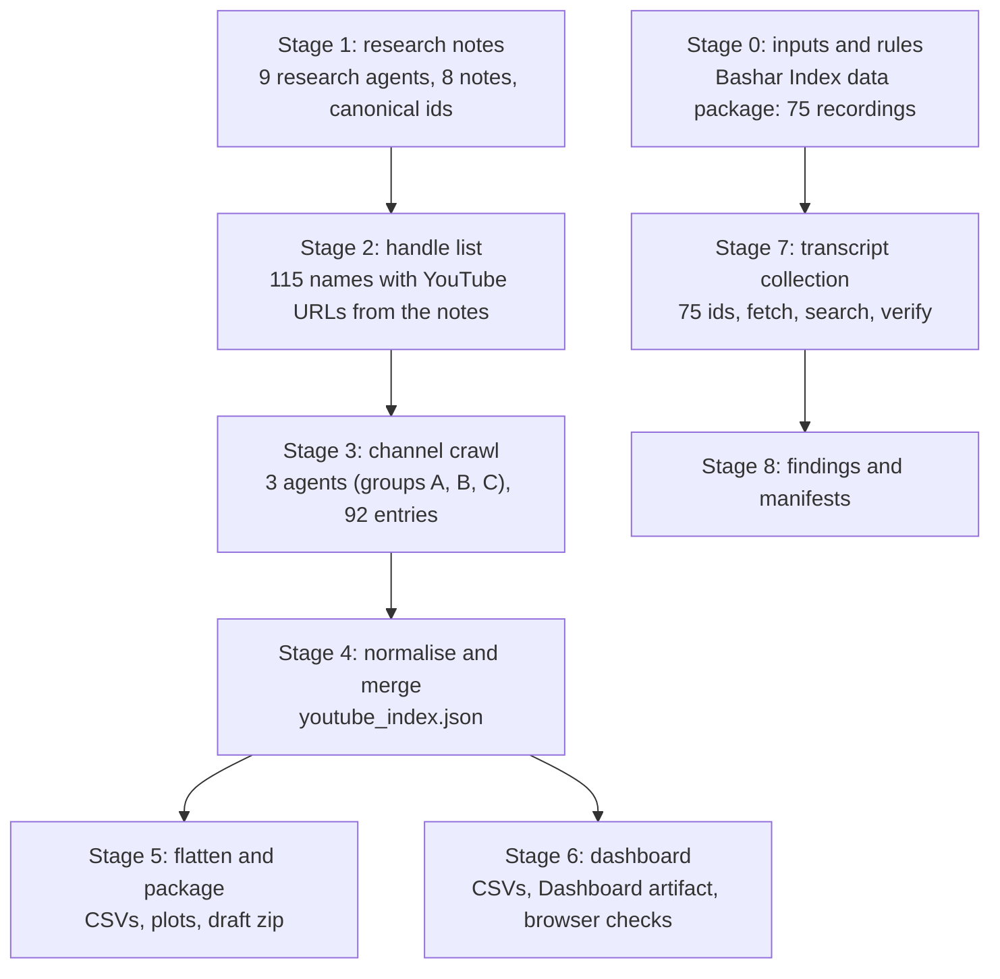

# ET channelers: YouTube crawl, index, dashboard and transcript pipeline

Work on the extraterrestrial-channeler thread of the Bashar Index: research notes on who channels whom, a crawl of their public YouTube channels, a flat index and dashboard of what was found, and a transcript pipeline used to answer questions about Bashar's recordings. This README follows the work from the first input to the last output, with the counts, the scripts that made each file, and what is missing.

**Snapshot.** Channel index observed 2026-10-23. Dashboard built 2026-10-26. Transcripts collected 2026-10-30. This README written 2026-11-11 from the files and session logs. Everything here is AI-generated (Claude, with sub-agents) and has not been through human editorial review. Claims are reported as claims, as in the rest of the repository.

**Not the Channeling Atlas.** [`channeling-atlas/`](../channeling-atlas/README.md) is a separate, larger and independently reviewed dataset (925 uploads). The numbers below use different denominators (92 people, 466 videos) and should not be added to or compared with the Atlas without the identity audit its roadmap calls N1.

## At a glance

Every number in this table is recomputed from the committed files by `python3 et-channelers/scripts/check_counts.py` (42 checks).

| What | Count |
|---|---|
| People / groups tracked | 92 |
| Fully crawled (channel page and latest uploads read) | 16 |
| Channel details from research notes only, video list not read | 38 |
| No YouTube channel recorded yet (the search never ran; absence is unverified) | 31 |
| Searched or flagged, not found | 7 |
| Video rows in the index | 466 (457 distinct video ids; 9 rows have no id) |
| Read from the 16 crawled channels | 449 (14 of the 16 hit the 30-video cap) |
| Entered from research notes, not crawled | 17 |
| Flagged as channeling, from the title | 244 |
| Title names an entity | 209 |
| Playlists / entity roll-ups | 12 / 15 |
| Bashar recordings targeted for transcripts | 75 |
| Transcript retrieved / errored | 55 / 20 |
| Other videos whose transcript was retrieved (6 more pages errored) | 9 |
| Videos with a transcript retrieved in total | 64 |
| Full transcripts saved as files (kept out of the repository) | 12 |

## Pipeline



Stages 1 to 6 are the channel index. Stage 7 is a separate branch that starts from the Bashar Index recordings, not from the crawl.

### Stage 0: inputs and ground rules

* Starting data: the Bashar Index data package already in this repository (`data/`): 75 structured digests of public recordings, `videos.json` (the same 75 with metadata), a 684-session catalogue.
* Scope chosen at the start: deep profiles plus a broad directory, ETs plus key non-ET channels, neutral documentary stance (no claim is endorsed), branch on this repository plus a dashboard artifact for hosting.
* Rules kept throughout: every fact carries a URL; relative dates stay relative ("3 weeks ago" as of 2026-10-23); counts and dates are never invented; recordings and transcripts are © Darryl Anka / Bashar Communications, Inc., so no transcript text is committed, the findings note keeps quotes to 30 words or fewer, and a spot check of the research notes found no quoted span over about 35 words; a page that fails with `client_error` is recorded and not fetched again through other routes.

### Stage 1: research notes (2026-10-22 to 10-23)

Nine general-purpose sub-agents covered eight topics with web search, page fetch and Firecrawl search/scrape, writing a markdown note with source URLs for each topic: 1985 to 2015 major channelers; the Ra material and pre-1981 lineage; Darryl Anka / Bashar; Athina Król / Ashtar lineage; Tyler Ellison / Ryok and smaller channels; YouTube-era channelers 2012 to 2026; Reddit, Wizard Forums and BALG (run twice, the second run a rerun, so one note); species catalogue, entities and skeptical coverage. By the session logs this was roughly 520 page fetches, 210 web searches, 110 Firecrawl scrapes and 215 Firecrawl searches.

* Output: [`research/notes/`](research/notes/), including `CANONICAL_IDS.md`, which fixes one slug per person so later stages join on the same id.
* Helper: [`scripts/research/reddit_dates.py`](scripts/research/reddit_dates.py) estimates the date of a Reddit post from its base-36 id by interpolating between dated anchor posts. Its dates are estimates.
* Four compile agents then turned the notes into drafts: `people` (only part 1, 23 people, was finished: [`youtube-index/people_part1.json`](youtube-index/people_part1.json)), entities/timeline/criticism, communities plus the YouTube index, and the final report ([`research/report/et-channelers-directory-and-timeline.md`](research/report/et-channelers-directory-and-timeline.md)). Planned schemas for the unfinished datasets are in [`youtube-index/DATA_SCHEMAS.md`](youtube-index/DATA_SCHEMAS.md).
* The report is a draft. Work was stopped on request on 2026-10-23 and the current state packaged as is.

### Stage 2: handle list

[`research/report/people_yt_handles.json`](research/report/people_yt_handles.json) lists 115 names, 46 of them with at least one YouTube URL the notes mention, and the note files they came from. It was prepared just before the crawl as a lookup for the crawl agents; it is not the crawl's input list and only partly overlaps it (45 of the 92 crawled entries have a channel URL or handle that appears on it). The crawl covered 92 people: 87 of the 129 people in `research/notes/CANONICAL_IDS.md` plus 5 ids the index added (L/L Research, Aetherius Society, Ashtar Command crew, Esther Hicks, Paul Selig). The 42 canonical people left out include many mid-century contactees, older channelers and anonymous or unnamed accounts.

### Stage 3: channel crawl (2026-10-23)

Three agents (groups A, B and C: 31, 31 and 30 people) looked up each person's channel and read the latest uploads through Firecrawl's `youtube-com` provider (`videos/resolve_channel`, `videos/search_videos`, `videos/channel_videos`, `videos/video_details`). For a crawled channel the provider returns the channel page and up to 30 recent videos with the displayed view count, relative publish time and length.

1. The raw provider result is saved to disk. [`scripts/crawl/extract.py`](scripts/crawl/extract.py) prints a compact listing of every channel in it.
2. The agent classifies each video from its title and description (`is_channeling`, `entity`, `note`) in a small spec file. [`scripts/crawl/build.py`](scripts/crawl/build.py) turns result plus spec into one JSON file per channel under [`youtube-index/per-channel/`](youtube-index/per-channel/).
3. [`scripts/crawl/assemble.py`](scripts/crawl/assemble.py) merges a folder of channel files into one group array and recomputes the summary counts: [`group_A.json`](youtube-index/group_A.json), [`group_B.json`](youtube-index/group_B.json), [`group_C.json`](youtube-index/group_C.json). Group C used compact per-channel files and its own [`scripts/crawl/group-C/build.py`](scripts/crawl/group-C/build.py). The output format is [`youtube-index/SCHEMA.md`](youtube-index/SCHEMA.md).
4. Firecrawl credits ran out part-way through. For every person the crawl could not reach, a stub with status `credits_exhausted` was written from the notes alone ([`scripts/crawl/notes_entries.py`](scripts/crawl/notes_entries.py), [`scripts/crawl/group-C/make_stubs.py`](scripts/crawl/group-C/make_stubs.py)). Of the 92 entries, 16 are `ok`, 75 are `credits_exhausted` and 1 is `not_found` (a search that found nothing).

Raw material kept: [`youtube-index/raw/`](youtube-index/raw/) (one saved provider result) and [`youtube-index/specs/`](youtube-index/specs/) (its classification spec).

### Stage 4: normalise and merge

[`scripts/build/build_youtube_index.py`](scripts/build/build_youtube_index.py) merges the three group files into [`youtube-index/youtube_index.json`](youtube-index/youtube_index.json). It is a compiler only and adds no new facts. It maps names to canonical person ids, parses integer subscriber and video counts out of the display text, collapses the status to four values, and builds per-person and per-entity roll-ups.

| Index status | Meaning | Entries |
|---|---|---|
| `ok` | Channel page and up to 30 recent videos read on 2026-10-23 | 16 |
| `metadata-only` | Was `credits_exhausted`; channel details come from the notes; the video list was not read, any videos listed are ones the notes recorded | 38 |
| `no_youtube` | No channel recorded in the notes and the planned search never ran; absence is unverified | 31 |
| `not_found` | A search found nothing, or the notes imply a channel but none was identified | 7 |

The original group-file status is kept in every entry as `original_status`.

### Stage 5: flatten and package (2026-10-23)

[`scripts/build/build_draft.py`](scripts/build/build_draft.py) (no network) flattened the index and notes into CSVs (channels, videos, entity roll-up, playlists, a harvest of YouTube links found in the notes, Bashar recordings by channel, a people directory, a draft timeline), two plots, a README and a zip. That zip was the unreviewed draft delivered on 2026-10-23. Its CSVs, plots and README are in [`draft-package/`](draft-package/): 127 people parsed from the notes, 530 dated timeline entries, 73 entity blocks, 136 YouTube links harvested from the notes, plus the channel, video, playlist and entity tables. The `notes/`, `data/` and report copies the zip also held are the same files as `research/notes/`, `youtube-index/` and `research/report/` here, so they are not duplicated. The draft README is a snapshot of 2026-10-23, kept as written: its statement that the dashboard update and a repository branch were "not built" predates Stage 6 and this folder. It lists what was known to be missing when work stopped (Reddit: nothing retrieved; Wizard Forums: two site searches; BALG: eleven threads read; the people table was parsed from free-text notes by label matching, and 18 of its 127 rows have no parsed entity, start date or first-public value). Its one-line gloss of `no_youtube` ("no channel was found or applies") is looser than the rule in `youtube_index.json`; trust the index rule. [`scripts/build/build_communities.py`](scripts/build/build_communities.py) builds the forum-communities table from the notes; its output file was not retained in this snapshot.

### Stage 6: dashboard (2026-10-26)

The index was flattened again into four dashboard tables in [`dashboard/data/`](dashboard/data/): `channels.csv` (92 rows), `videos.csv` (466), `playlists.csv` (12) and `entities.csv` (15). Subscriber and view counts are parsed to numbers, `channeling` is yes/no, and every row has an id and the observed date. That export ran inline and was not saved as a script; `build_draft.py` is the closest saved equivalent, and `check_counts.py` verifies the tables against the JSON.

The tables feed a Dashboard-type Claude Artifact called "Channeler YouTube index" (private to its owner, so it is not linked here). The page source is [`dashboard/index.html`](dashboard/index.html): headline figures, a coverage bar, entity bars, an audience chart and channel, video and playlist tables. Two live fixes (a duplicated word and a missing observed-date fill) were applied and the live page was checked identical to this copy.

Browser check: [`dashboard/qa/run.py`](dashboard/qa/run.py) loads a harness page in headless Chromium at 1100 px and 400 px wide and reports script errors, horizontal overflow and row counts. [`dashboard/qa/page_check.js`](dashboard/qa/page_check.js) is the dashboard's page script as it was extracted for that harness. It predates the observed-date fix, so `dashboard/index.html` has two more lines in its script.

### Stage 7: transcript collection

Used for the question "what did Bashar say about astrology, star signs and calendars as a permission slip?" (2026-10-30). It starts from the Bashar Index recordings, not from the crawl.

1. **Targets.** The 75 video ids in [`transcripts/scripts/all_ids.txt`](transcripts/scripts/all_ids.txt), taken from `data/videos.json`.
2. **Source.** Auto-caption transcript pages at youtubetotranscript.com (`/transcript?v=<id>`) for YouTube re-uploads of full sessions. Direct watch pages were blocked or bot-protected.
3. **Two retrieval routes.**
   * Firecrawl scrape of the transcript page. The result was saved as JSON, then [`extract.py`](transcripts/scripts/extract.py) or [`ingest_all.py`](transcripts/scripts/ingest_all.py) wrote `<id>.txt`. 12 videos were saved this way; the files stay out of the repository.
   * Nine `web-fetch` sub-agents (five chunks of the list, one for short clips, two for the longest sessions, one for two astrology clips) each fetched a handful of pages and handed back matching passages and verbatim excerpts. A fetch returns about 40,000 characters, so long sessions need several calls. Five sweep agents hit their turn limit, so each was asked for a partial hand-back and the uncovered ids were rerun in smaller batches.
4. **Search.** [`grep_ctx.py`](transcripts/scripts/grep_ctx.py) prints merged context windows around a regex for the saved files; the agents did the equivalent on the pages they fetched. The 75 AI digests in `data/digests/` were used only as a secondary index, because they had missed some passages.
5. **Verification.** Each quote used in the findings was checked against the caption text it came from. Where the text came from a sub-agent or from a read that left no copy, the findings table says so.
6. **Failures.** 20 pages returned `client_error` and were not retried through other routes. Of those 20, two (`mk_yQrOQHJs`, `tskKYl3w0J8`) are duplicate uploads of a session that was read (`DvWNnqnBAjc`); the other 18 are unread, including three full sessions.
7. **Other transcripts.** Sub-agents working on profiles and on an experiment retrieved nine more videos' transcripts (six more pages errored): [`transcripts/other_videos_manifest.csv`](transcripts/other_videos_manifest.csv).
8. **Manifests.** [`transcripts/bashar75_manifest.csv`](transcripts/bashar75_manifest.csv) records, for each of the 75 ids, retrieved or error, how it was read and whether a full text was saved locally. It was built by [`build_manifest.py`](transcripts/scripts/build_manifest.py) from the agent logs ([`count_from_agent_logs.py`](transcripts/scripts/count_from_agent_logs.py)) and the saved-file list. Two recordings were read in the main session before those logs begin; they are marked `main_session_inline`.

### Stage 8: findings

[`transcripts/findings/astrology-calendars-permission-slip.md`](transcripts/findings/astrology-calendars-permission-slip.md) answers the question with short quotes, the recording each came from, how it can be re-checked, and what was not found. Answers given in chat on other questions (names, hedonism) are not archived here.

## Limits to keep in mind

* **A sample, not a census.** The 92 are the people the crawl covered, not the whole field. The people lists were never merged into one master list: 129 canonical ids, 127 rows parsed into the draft directory, 115 names on the handle list and 92 crawled. Only the 30 most recent uploads were read per crawled channel, so older videos are not represented, and 14 of the 16 crawled channels hit that cap.
* **Most of the list was not crawled.** 76 of 92 entries were not crawled and carry only the 17 videos the notes happened to record. The 31 `no_youtube` entries say only that no channel was found in the notes.
* **Titles drive the labels.** `is_channeling` and `entity` come from video titles and descriptions as read by the agents. They were not checked against the video content.
* **Display text, as of 2026-10-23.** Views and subscriber counts are the numbers shown that day. Only 3 of 466 videos have an ISO publish date; the rest are relative ("3 weeks ago").
* **Transcripts are auto-captions of fan re-uploads.** Wording can be off, title dates are the uploaders' labels, and the unread 20 may change any "not found" conclusion. Only 12 transcripts exist as standalone files, and those are not committed.
* **Some numbers cannot be rebuilt from this repository alone.** Tool-call volumes, per-id fetch attempts and the 55/20 split come from sub-agent logs that are not committed. The manifests record their results; `check_counts.py` checks everything else.
* **Raw provider responses are data, not instructions.** One Firecrawl response carried a block of "agent hints" asking the reader to tell the user about credits and an upgrade link; it was ignored and disclosed.

## Not in this repository

Full transcripts and the sub-agent logs; three contact email addresses that appeared in the research notes, and in one cell of the draft people table that was parsed from them (all replaced with `[email redacted]` in this copy, so that one cell differs from the delivered zip); raw third-party page scrapes used as research input (a Kryon channel list, a Lieder wiki page, Amazon author pages); screenshots; the private dashboard link; and the separate frequency-of-place experiment, which lives on the `experiment-frequency-of-place` branch.

## Repository map and where the files came from

| Here | Original location in the session |
|---|---|
| `research/notes/` | `research_notes/ET channelers directory and timeline/*.md` |
| `research/report/` | `reports/` (file renamed to remove spaces) |
| `youtube-index/` | the `youtube_index/` notes folder, `etc_site/data/` and `etc_site/data/_parts/` |
| `draft-package/` | the delivered draft zip's `csv/`, `plots/` and README (only the parts not already stored elsewhere here) |
| `youtube-index/per-channel/group-A, group-B, group-C` | scratch folders `channels/`, `ytB/channels/`, `groupC/channels/` |
| `dashboard/` | scratch folders `dash/` and `harness/` |
| `scripts/`, `transcripts/scripts/` | scratch scripts, copied without changes |

The scripts keep the absolute paths they had during the session (for example `/home/claude/etc_site/data/`). Point the constants at the top of each file at this folder before rerunning, as with `src/build.py` at the repository root. The Bashar Index data package the scripts call `work/data_pkg/package` is `data/` here. `scripts/check_counts.py` and `transcripts/scripts/build_manifest.py` are the only files written for the repository and use relative paths or arguments.

## Planned, not done

* Read the video lists for the 38 `metadata-only` channels that already have handles (needs Firecrawl credits), and search for the 31 `no_youtube` and 7 `not_found` people.
* Decide a sampling rule before collecting transcripts for the 244 channeling-flagged videos (the Atlas roadmap item N3 is the model to follow).
* Retry the 20 unread Bashar pages later and fill the remaining gaps in the findings.
* Reconcile this index with the Atlas identity table before any joint count is quoted.

## Rerunning the checks

```sh
python3 et-channelers/scripts/check_counts.py   # 42 checks, stdlib only, no network
```
