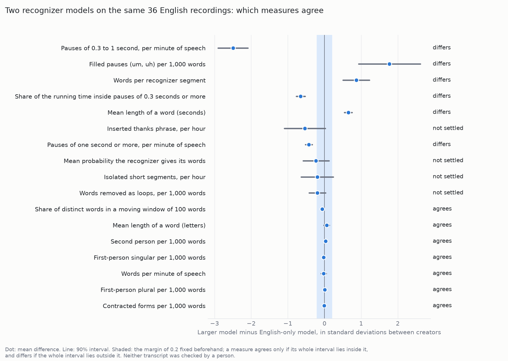
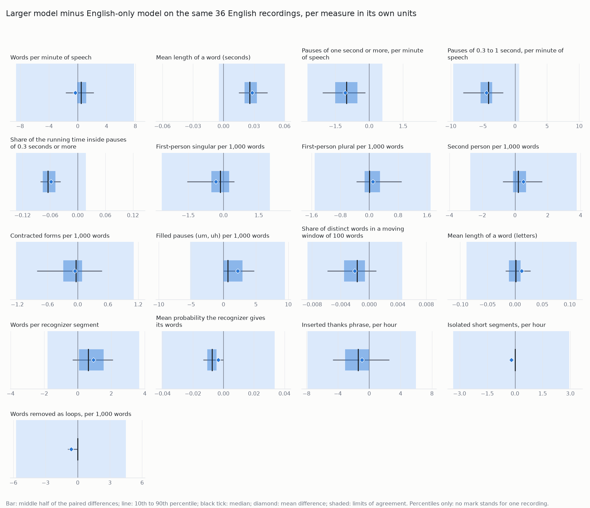

# Results of the registered hypotheses

One row per registered hypothesis, whatever its outcome. A hypothesis that leaves the paper's headline claims
stays in this table. Numbers only; creators are never named.

The first round of registered tests (H1, H2, H4, H5, H6 and H9) ran on the hold-out creators on 2026-11-21 with the
code and constants fixed by freeze 2 (16:10 UTC). Holm runs over all ten hypotheses (m = 10, family-wise 0.05);
every Holm-adjusted p is 1 and no step passed. Every label behind these tests was made by language models from
frozen prompts and no person checked it, so every verdict is model-coded; agreement between models is agreement,
not a measure of correctness. The first-round rows below give the verdicts as the public results file states them. That file,
[`first-round-2026-11-21.md`](first-round-2026-11-21.md) (machine-readable twin `first-round-2026-11-21.json`,
republished as fixes were made; its header gives the time), holds both versions of every amended test, the reliability gates on R-hold, the
verification of the labels and the robustness rows.

| Id | Hypothesis | State | Estimate | Verdict by the registered rule | Reading |
|---|---|---|---|---|---|
| H1 | The claimed voice is slower than the creator's own voice | **run in the first round, 2026-11-21** (model-coded) | not published (the result is not determinable) | not determinable: too few eligible creators (below the minimum of 12) | eligible creators below the minimum of 12; Holm-adjusted p 1; uninformative; see the first-round file |
| H2 | Checkable forecasts are worded less firmly | **run in the first round, 2026-11-21** (model-coded) | not published (the result is not determinable) | not run for want of an instrument: below the reliability floor (the forecast class of record fails gate D on R-hold: kappa 0.507 [90% 0.169, 0.792] against the floor 0.60 and the bound 0.50; A10.5) | eligible creators at least the minimum of 9; Holm-adjusted p 1; uninformative; see the first-round file |
| H3 | First-person singular is denser at the trimmed edges of a recording than in its middle | **tested 2026-11-20** | U = 0.169 on 17 hold-out creators, 169 recordings (90% interval -0.130 to 0.495; shift p = 0.0007) | passed its registered rule (supported by it); not determined at creator level | **withdrawn: dropped by the owner 2026-11-20** (A6): fragile, see below; counted as run, it enters Holm at p = 1 |
| H4 | Fewer contractions in the embodied claimed voice | **run in the first round, 2026-11-21** (model-coded) | not published (the result is not determinable) | not determinable: too few eligible creators (below the minimum of 12) | eligible creators below the minimum of 12; Holm-adjusted p 1; uninformative; see the first-round file |
| H5 | World claims in channelled recordings, practice in own-voice talks | **run in the first round, 2026-11-21** (model-coded) | not published (the result is not determinable) | not determinable: too few eligible creators (below the minimum of 12); a reliability gate on R-hold was not passed (the sentence codes fail gate C: 0.816 [90% 0.757, 0.867] against the floor 0.85; A10.5) | eligible creators below the minimum of 12; Holm-adjusted p 1; uninformative; see the first-round file |
| H6 | The claimed voice rarely asks listeners to buy or enrol | **run in the first round, 2026-11-21** (model-coded) | not published (the result is not determinable) | not determinable: too few eligible creators (below the minimum of 12) | eligible creators below the minimum of 12; Holm-adjusted p 1; uninformative; see the first-round file |
| H7 | More alike near almanac dates | not run | | | not run: it needs the replication wave, and none exists (A4; decision of 2026-11-21 04:55 (h)); enters Holm at p = 1 |
| H8 | The H3 contrast is larger than in sermons and wellness talks | **dropped by the owner 2026-11-20** (A9) | | | its contrast is H3's, shown to be biased; the comparison set was never collected; counts as run with p = 1 |
| H9 | Same family of beings: shared subject matter, not shared style | **run in the first round, 2026-11-21** (model-coded) | not published (the result is not determinable) | not determinable in both versions (amended: too few eligible creators (fewer than 5 of 8); registered: the family-label permutation cannot reach the first Holm step (eligible creators: fewer than 5; the number of distinct labelings is not published)) | eligible creators fewer than 5, minimum 8; Holm-adjusted p 1; uninformative; see the first-round file |
| H10 | Passed dates are returned to less often | not run in the first round | | | not run in the first round (decision of 2026-11-21 04:55 (m)): like H7, it has data only on a replication wave, and none exists; enters Holm at p = 1 |

## Exploratory round (2026-11-21 to 22)

The exploratory round ran after the registered tests had run and been published: it began at 2026-11-21 23:17 UTC,
under the registered [exploratory reporting plan](../exploratory-reporting-plan.md) and its addenda 1 to 3, with code
written after freeze 2. Its release, [`exploratory-2026-11-21/README.md`](exploratory-2026-11-21/README.md), gives the
status of every output the plan lists (172 outputs: 111 reported, 1 superseded, 60 not run), the public tables of the
round's packages and of the outputs built before it, the round's hold-out contact log and deviation table, and a
gallery of figures ([`exploratory-2026-11-21/gallery/index.html`](exploratory-2026-11-21/gallery/index.html)).
Everything in it is exploratory (registry A2); not a test of H1-H10. It holds no test verdict and changes none of the
verdicts above. Its hold-out outputs are printed beside the seen creators' values and never pooled with them, and its
labels are model-coded and not checked by a person.

## H3 in full

The procedure was frozen in [`../registry.md`](../registry.md) and committed before any hold-out transcript
was read; the code is [`../code/h3_position.py`](../code/h3_position.py). Files:
[`h3-holdout.json`](h3-holdout.json) (the registered test) and
[`h3-seen-exploratory.json`](h3-seen-exploratory.json) (the 61 creators seen earlier; exploratory).

| | Hold-out creators (registered test) | Seen creators (exploratory) |
|---|---|---|
| Creators, recordings | 17, 169 | 61, 558 |
| U, three minutes trimmed from each end, artefact filter on | 0.169 | 0.019 |
| 90% interval over creators | -0.130 to 0.495 | -0.129 to 0.165 |
| One-sided p against circular shifts | 0.0007 | 0.12 |
| Creators with a positive U | 9 of 17 | 36 of 61 |
| First-person singular per 1,000 words, edges against middle | 29.1 against 26.0 | 29.2 against 28.8 |
| U without the artefact filter | 0.166 | 0.019 |
| U without the trim (reported, not tested) | 0.348 (output of the frozen procedure; see the note below) | 0.427 |

**The hold-out and the positional rule.** Under the owner's rule of 20 November 2026, displays of speech by
position in the recording showed the seen creators only until freeze 2 (2026-11-21, 16:10 UTC); until the
exploratory round's release, no positional estimate on the hold-out other than H3's registered output was published. The two hold-out numbers
above are the output of H3's frozen procedure, which was registered to report the untrimmed contrast beside the test; they
are kept here and in the paper as that output, and the findings dashboard shows only the registered test for the
hold-out. The rule ran until freeze 2 by its own terms (corrections C10) and lapsed there, and the exploratory
reporting plan registers hold-out positional outputs for after freeze 2. They are published in the exploratory
round's release ([`exploratory-2026-11-21/`](exploratory-2026-11-21/README.md)): rv-D3-H (time outside recognized
speech by position), H3-X (H3 at the creator level) and E3-H (pace and address by position), each beside the seen
creators and never pooled with them (lead's decision D40, 2026-11-22; addendum 3 item 8).

**What the registered rule says.** Supported: the shift test passes the strictest Holm threshold (0.005) and
the estimate is above the smallest effect of interest (0.10).

**Why the result is fragile.** Three things point the other way, and they are stated here so that the verdict
is not read for more than it is.

1. The interval over creators includes zero, and only 9 of the 17 creators have a positive U. A few creators
   with a large contrast carry the mean.
2. The 61 creators seen earlier, a sample three and a half times larger, show a raw trimmed contrast of 0.019,
   but the contrast's no-effect value under its own reference is -0.063; recentred, the seen value is 0.083
   (90% t interval -0.046 to 0.211; 41 of 61 creators positive; creator sign-flip p 0.15). That is not
   distinguishable from zero at creator level (exploratory, panel round 2; registry amendment A10.7).
   The hold-out is the tail of the transcription run, not a random draw.
3. The two procedures answer different questions. The circular shift asks whether position matters in these
   recordings at all, and it does not count the differences between creators as uncertainty. The interval
   does. The catalogue's own first rule makes the creator the unit, and by that standard the hold-out cannot
   tell 0.169 from zero: it was sized to detect about 0.54. Applied to random sets of 17 seen creators under a
   creator-level placebo (one rotation per creator, 4,000 sets), the registered shift test rejected at its
   nominal 0.5% in 1.3% of sets (2.0% at 8 creators; exploratory, panel round 2).

**Reading.** With the first and last three minutes removed, the evidence that self-reference recedes inside a
recording is weak and inconsistent between the two samples. Without the trim the contrast is large in both
(0.35 and 0.43): the surplus of "I" sits in the first and last three minutes.

**Decision.** The owner dropped H3 on 2026-11-20 after reading this result (registry amendment A6). It is
out of the claims of the paper and it is closed: no further confirmatory test, on the replication wave or
elsewhere. This row and the two result files stay, so that the count of hypotheses tested is honest: H3 was
tested, the first round then ran the registered tests of H1, H2, H4, H5, H6 and H9 (five not determinable, one not
run for want of an instrument), and none is claimed. Holm correction still counts H3 as run. The untrimmed observation remains as a
description of how recordings open and close.

**What this changes for the hypotheses run after H3** (amendment made after seeing H3, in the stricter
direction): a hypothesis is called supported only if its registered test passes and the 90% interval over
creators excludes zero. This is recorded as amendment A5 in the registry.

## BR. The two recognizer models on the same audio

Run on 2026-11-20. The transcription run used an English-only model for English and a larger multilingual model
for the other languages, so no English recording had been through both. 36 English recordings of 5 to 60 minutes
with at least 2 minutes of speech and 200 words (one per creator: all but fewer than 5 from the creators seen before
the freeze and the rest from creators outside both the seen and the hold-out sets; drawn by seed over thirds of pace
and of time without speech; hold-out creators excluded) were transcribed again by the larger model; none failed a
check. On the seen creators' pairs alone every verdict below is the same. Code: [`../code/br_bridge.py`](../code/br_bridge.py), SHA-256
`77262c2fff13b856dcabcc657dd8d06883a7e84535dd44b4b57c65339126a867`, committed before the run on all 36 pairs (it had been tried on the
25 pairs finished at the time; nothing was changed). Files: [`br-bridge.json`](br-bridge.json) and the
figures in [`figures/`](figures/). The per-recording pairs (`br-pairs.csv`, one recording per creator) were
moved to the private archive on 20 November 2026 under the owner's rule that nothing public is per creator or per
recording; [`../code/br_figures.py`](../code/br_figures.py) now draws the first figure from them as percentiles only.

The rule is the catalogue's, fixed beforehand: a measure can be compared across the two models ("agrees") only if
the 90% interval of the mean paired difference lies inside 0.2 standard deviations between creators. That spread
comes from the creators seen earlier with three or more recordings (all but fewer than 5 of the 71 seen creators;
1,112 recordings). "Differs" means the whole interval lies outside the
margin; "not settled" means 36 recordings cannot say. The three-way wording is added here for reading;
the registered rule has two outcomes, and "differs" and "not settled" both count as not comparable.

| Measure | English-only model | Larger model | Difference in spreads between creators (90% interval) | Verdict |
|---|---|---|---|---|
| Share of distinct words in a moving window of 100 words | 0.648 | 0.646 | -0.06 (-0.09 to -0.03) | agrees |
| Mean length of a word (letters) | 4.3 | 4.3 | 0.06 (-0.01 to 0.13) | agrees |
| Second person per 1,000 words | 45.9 | 46.4 | 0.03 (0.00 to 0.05) | agrees |
| First-person singular per 1,000 words | 32.6 | 32.2 | -0.02 (-0.05 to 0.00) | agrees |
| Words per minute of speech | 147.5 | 147.1 | -0.02 (-0.09 to 0.05) | agrees |
| First-person plural per 1,000 words | 13.9 | 14.0 | 0.01 (-0.02 to 0.04) | agrees |
| Contracted forms per 1,000 words | 16.7 | 16.6 | -0.01 (-0.03 to 0.01) | agrees |
| Pauses of 0.3 to 1 second, per minute of speech | 8.9 | 4.5 | -2.49 (-2.90 to -2.09) | differs |
| Filled pauses (um, uh) per 1,000 words | 0.622 | 2.8 | 1.77 (0.93 to 2.62) | differs |
| Words per recognizer segment | 12.4 | 13.3 | 0.87 (0.51 to 1.23) | differs |
| Share of the running time inside pauses of 0.3 seconds or more | 0.201 | 0.143 | -0.65 (-0.77 to -0.53) | differs |
| Mean length of a word (seconds) | 0.350 | 0.378 | 0.65 (0.54 to 0.75) | differs |
| Pauses of one second or more, per minute of speech | 3.6 | 2.6 | -0.43 (-0.52 to -0.33) | differs |
| Inserted thanks phrase, per hour | 2.3 | 1.3 | -0.54 (-1.10 to 0.02) | not settled |
| Mean probability the recognizer gives its words | 0.964 | 0.961 | -0.23 (-0.59 to 0.12) | not settled |
| Isolated short segments, per hour | 0.443 | 0.243 | -0.20 (-0.64 to 0.24) | not settled |
| Words removed as loops, per 1,000 words | 3.5 | 2.8 | -0.19 (-0.42 to 0.03) | not settled |

**Robustness (panel round 2, exploratory).** An independent re-analysis from the stored pairs reproduces all 17
intervals above. The table below adds, for the same 36 pairs and in the same units, an exact signed-rank 90%
interval and the limits of agreement (mean difference plus or minus 1.96 SD of the differences). The signed-rank
interval gives the same seven agreements; five of the six measures that differ also differ under it, filled pauses
cannot be read by it because many of their differences are zero, and it puts the mean word probability outside the
margin. Leaving out any one recording changes none of the 13 settled verdicts, and on the seen creators' pairs alone
every verdict is the same. The four rows that are not settled stay unread either way.

| Measure | Exact signed-rank 90% interval | Verdict by it | Limits of agreement |
|---|---|---|---|
| Share of distinct words in a moving window of 100 words | -0.09 to -0.04 | agrees | -0.26 to 0.14 |
| Mean length of a word (letters) | -0.02 to 0.04 | agrees | -0.44 to 0.55 |
| Second person per 1,000 words | 0.00 to 0.03 | agrees | -0.15 to 0.21 |
| First-person singular per 1,000 words | -0.03 to 0.00 | agrees | -0.19 to 0.14 |
| Words per minute of speech | 0.01 to 0.05 | agrees | -0.51 to 0.46 |
| First-person plural per 1,000 words | -0.01 to 0.03 | agrees | -0.18 to 0.20 |
| Contracted forms per 1,000 words | -0.03 to 0.00 | agrees | -0.16 to 0.14 |
| Pauses of 0.3 to 1 second, per minute of speech | -2.85 to -2.16 | differs | -5.34 to 0.35 |
| Filled pauses (um, uh) per 1,000 words | -- | not readable (many zero differences) | -4.11 to 7.66 |
| Words per recognizer segment | 0.44 to 1.02 | differs | -1.65 to 3.38 |
| Share of the running time inside pauses of 0.3 seconds or more | -0.77 to -0.63 | differs | -1.49 to 0.19 |
| Mean length of a word (seconds) | 0.55 to 0.69 | differs | -0.09 to 1.39 |
| Pauses of one second or more, per minute of speech | -0.51 to -0.33 | differs | -1.09 to 0.23 |
| Inserted thanks phrase, per hour | -- | not readable (many zero differences) | -4.44 to 3.36 |
| Mean probability the recognizer gives its words | -0.60 to -0.40 | differs | -2.70 to 2.23 |
| Isolated short segments, per hour | -- | not readable (many zero differences) | -3.26 to 2.87 |
| Words removed as loops, per 1,000 words | -- | not readable (many zero differences) | -1.76 to 1.38 |

**What it shows.** 7 of 17 measures agree, 6 differ and 4 are not settled.

* What is counted from the words agrees on average over 36 English recordings of 5 to 60 minutes: pace, pronoun
  rates, contracted forms, variety and length of words. This is a statement about the mean. Single recordings
  differ more: the limits of agreement are -0.51 to +0.46 between-creator SD for pace and -0.44 to +0.55 for word
  length in letters, and 5 of the 36 recordings differ by more than the 0.2 margin on pace. The pace difference
  falls as the share of time in pauses rises (Spearman -0.43), so a creator with an unusual delivery can sit well
  off the mean. The two transcripts differ in 3.5% of words at the median (quartiles 2.7% and
  4.8%). Neither transcript is a human reference,
  so this is disagreement between models and not an error rate.
* What depends on word timing differs. The larger model gives words 28 ms more
  length on average and about half as many short pauses. Pause counts and pause shares must not be compared
  across the two models, and a split of tempo into pause and articulation parts holds only inside one model.
* Filled pauses differ most in substance: the larger model writes "um" and "uh" about
  4.5 times as often
  (2.8 against 0.6 per 1,000 words). Any count of fillers
  measures the recognizer as much as the speaker.
* Segment length differs, which is one more reason not to use recognizer segments as units.

**What it changes.** The two models agree on average on English audio of 5 to 60 minutes for pace, pronoun rates,
contracted forms and the variety and length of words. This removes the recognizer model from the confounds of a
comparison across languages (roadmap phase 7d, experiment LG). It does not remove language or creator, and it does
not make pace, pronoun rates or contractions comparable across languages, where a word is a different unit and
subject pronouns can be dropped. It says nothing about the larger model on the six other languages or about
translated text, so other languages stay description only. Single recordings or single creators are compared across
the models only with the limits of agreement in view. No timing or filler measure is compared across the models.
H1's rate and H4's contraction share rest on measures that agree; the pause split named beside H1 (E4) is limited
to one model and to pauses after the seam rule (the capped, weighted rule; registry, 2026-11-21 03:08 UTC): the
30-second decoding grid itself makes about 3% of pauses of 0.3 to 30 seconds. The bridge says nothing about
agreement with what was actually said: that needs transcripts made by listening, which do not exist.
