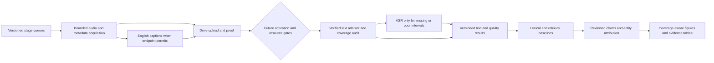

# Channeler corpus: collection, transcription and analysis plan

**Operational clarification, November 18 00:05:09 UTC:** this is the dated scientific plan. Separately admitted acquisition now has 128 verified native pairs and 77 native ASR bundles, with 156 deduplicated audio entries and 122 with saved text including publisher editions. Source and ASR continuation are active; see [current HANDOFF](../../HANDOFF.md). The calibration experiment, embeddings and scientific corpus-analysis jobs described below remain unexecuted. The original 00:21 counts and disabled-job statements below describe that checkpoint, not the current acquisition worker.

Decision record: 16 November 2026, America/New_York. Operational checkpoint: 17 November 2026, 00:21 UTC. **This is a researched implementation plan, not completed corpus analysis. Transcription, model downloads, embeddings and analysis jobs remain disabled.** The existing published prediction records are unchanged.

## What is ready

The current local YouTube lane has 47 audio/metadata pairs verified on Drive and 20 verified English-caption bundles across 17 videos. These are this lane's counts, not the totals of the older podcast, text and Bashar archives. The merged index contains 65,345 unique video IDs across 70 tracked channels: 1,340 in newest 20, 3,270 in newest 50 and 62,075 in the remaining archive. Indexing does not mean media or transcripts have been acquired.

The requested [Multidimensional Soul channel](https://www.youtube.com/channel/UC1jF0BbiGpAB6ekXgByEPYg), operated as @Akanksshaa, contributed 1,417 listing rows: 730 Videos, 684 Shorts and three streams. It is registered as an interview host. Episode guests, actual speakers and their attributed entities require separate evidence; channel ownership never assigns every guest's material to the host.

Downloads retain native audio, sanitized metadata and available **English publisher captions plus original English automatic captions**, including regional English tracks. Other languages and machine translations are excluded. Publisher and automatic versions remain separate. There is no duration filter. Source tabs determine Videos/Shorts/Recorded streams/Unclassified, not guessed duration thresholds. Stages are newest 20, extend to 50, then archive the indexed remainder.

The PO-token provider/mweb repair recovered one blocked file, including full Drive verification. A subsequent paced four-worker trial received a new media 403. The supervisor now waits until **2026-11-18 00:11:16 UTC / November 17, 7:11 p.m. Eastern**, preserving its retry budget. Captions independently wait until November 17, 23:20:02 UTC. There is no claim that the provider universally fixes 403 or 429. See [download research and operating limits](../../pipeline/WINDOWS_DRIVE.md).

## Expert panel and evidence trail

Three parallel owners performed two research rounds, followed by a third critical review. The research lead independently opened and reviewed the first-party pages supporting the final relationship table, then integrated the reviewers' corrections. This is agent review, not independent human validation of the claimed phenomena.

| Owner | Round 1: map the problem | Round 2: challenge and narrow | Round 3: acceptance review |
|---|---|---|---|
| Systems / transcription | [Hardware, engines and throughput](transcription-panel-round1.md) | [Windows dependencies, storage and evaluation](transcription-panel-round2.md) | [Reservations, leases and resource gates](panel-round3-systems-review.md) |
| Analysis / statistics | [Questions, methods and figures](analysis-panel-round1.md) | [Schemas, retrieval and sampling](analysis-panel-round2.md) | [Leakage, uncertainty and evidence boundaries](panel-round3-analysis-review.md) |
| Discovery / identity | [Candidate scouting](discovery-panel-round1.md) | [Primary-source relationships](discovery-panel-round2.md) | [Attribution and comparison audit](panel-round3-discovery-review.md) |

Search accounting is recorded per report: systems used five searches/25 result slots in each search round; analysis used five searches/50 slots then five/25; discovery used seven/65 then five/55. Slots include repeats and are not independently verified sources. Reports distinguish fetched pages, failed calls and source metadata. The lead's recovery research and independent source review are additional, not a third full search round. Model version, benchmark and runtime claims link to primary documentation in the reports; no source benchmark is presented as this laptop's measured throughput.

The [channeler–entity table](channeler-entity-table.md) and [relationship CSV](discovery-relationships.csv) now contain **119 sourced relationships for 31 people and 90 source labels**. The original study's 115 relationships for 28 people used 30 first-party support URLs; the [three-channel intake acceptance](../intake-three-channels-source-review.json) adds four relationships supported by three additional official-page URLs, for **33 distinct relationship-support URLs**. The official English companion to Ayako's Japanese profile was also reviewed as corroboration and is not an additional relationship row. They remain a discovery batch, not an exhaustive registry of every tracked person. Relationship types distinguish attributed channeling, series descriptions, light-language/code claims, guide associations and reported contact; historical claims do not establish current or per-video performance. New candidates are not automatically inserted into download queues: channel ownership and episode relevance still need intake checks. The separately requested channels have been registered; Infini Global remains a publisher with unverified ownership, and the requested alternative-human Bashar video's performer remains unresolved.

## Data organization and identity

Keep immutable raw artifacts in the private archive, with content hashes, Drive object identity, verified size/hash and a versioned manifest. Public outputs contain permitted aggregate data and guarded excerpts, never full transcripts or contacts. A future logical layout is:

```text
collection / source-tab / video-id / native-audio + sanitized-metadata
collection / source-tab / video-id / captions / language / publisher-or-auto / bundle
derived / work-id / text-version-id / segments + provenance + quality
analysis / run-id / frozen-input-manifest + configuration + tables + figures
```

Existing verified paths remain valid; the catalog is the mapping layer, not a reason to move archived objects. Upload new immutable versions; delete local bytes only after remote proofs and active-reader leases permit it.

| Record | Meaning and required distinctions |
|---|---|
| `person`, `collection`, `appearance` | A human, a source channel, and an episode role. Owner, interviewer, guest, narrator and claimed channeling speaker are separate. Diarization labels are recording-local. |
| `entity_concept`, `claimed_entity_instance` | A comparison label versus a claimant/source-scoped attribution. Jesus/Yeshua can share an alias family without asserting external identity. Arcturian councils, a civilization and individual beings do not automatically merge. |
| `work`, `item`, `leakage_group_id` | A distinct work, its source manifestation, and the family used for splits. Reposts and derivative clips share a leakage group when supported; clips can remain distinct works. |
| `text_version`, `span` | Original track/ASR version, content/config hashes, raw segment IDs, character offsets and start/end times. Preserve uncertainty, language, speaker and coverage. |
| `relationship_record`, `claim` | A biographical attribution versus a statement in a dated source span. The discovery CSV's historical `claim_instance_id` names a relationship record; it must not be imported as a transcript claim ID. |
| `claim_evidence`, `run` | Evidence search/appraisal state and reproducible input/model/prompt/configuration versions. Repeated use of one study is not independent replication. |

Caption ZIP ingestion must check object proofs, bounded decompression, paths, raw/derived hashes and the embedded provenance before accepting segments. The catalog compatibility fix now maps native `raw_format` or legacy `ext` to `json3`/`vtt`; invalid/conflicting values remain unknown. A future adapter still validates the actual bundle. Prefer text **by covered interval and quality**: a short publisher track must not erase the rest of a full automatic track. Preserve both original tracks; any assembled view records interval-level lineage and deduplication decisions.

## Deferred transcription and concurrency

Measured hardware is an RTX 4070 Laptop GPU with about 8 GB VRAM, about 31.7 GiB RAM and Python 3.12.9. The first candidate is faster-whisper 1.2.1/CTranslate2 4.9.0 with an English distilled Whisper model, compared against a larger Whisper reference on a fixed sample. The reports document CUDA 12.8 Windows packaging and a smoke-test gate; compatibility and speed have not been demonstrated here. Parakeet remains a challenger contingent on Windows/runtime/resource viability, not an installed stack.

Use one GPU-owning process, bounded decoding, batched inference with adaptive admission and resumable chunks. CPU workers handle network I/O, parsing and lightweight indexing; GPU-capable inference stays on the GPU. No silent CPU transcription fallback. A **70% rolling utilization target** can be approached with batch size and duty-cycle pauses; native Windows does not provide this plan a hard instantaneous utilization ceiling. Measure peak VRAM, RAM, real-time factor, energy if available, and thermal effects under that policy before projecting completion times.

The current collector enforces its own 17 GB private-root budget. Future simultaneous ASR requires a shared interprocess reservation ledger and leases respected by cleanup. Until implemented, use serial acquisition/processing phases. Within the owner's 20 decimal GB total allowance, preserve 2 GB and account for tools/repositories outside the private root. Measured current usage is about 0.115 GB private plus 0.691 GB tools/repository. Model weights, environment installation, temporary downloads, decoder scratch, caches and derived outputs all count. Installing a 3.1 GB model may temporarily require another 3.1 GB staging allocation; runtime quantization does not halve the download. Reduce audio spool admission during installation rather than exceed the budget.



## Evaluation register: distinct samples, no pooled success claim

These proposals supersede the first-round suggestion of up to 120 evaluation items. They are separate studies with different denominators, not additive sample sizes or a power calculation.

| Panel | Proposed frame and split | What it measures |
|---|---|---|
| ASR gold | Six development and 18 held-out recording-family excerpts; blinded human reference transcripts; names, dates/numbers, negation, overlap and silence represented | WER plus consequential token errors, hallucinated speech, timestamp/coverage errors and resource cost. No threshold has been achieved. |
| Corpus/attribution audit | Initial 30-work development audit across source types and coverage states; rubric development only | Identity, duplication, speaker/entity assignment, text quality and feasible annotation effort. Not a held-out accuracy estimate. |
| Extraction evaluation | Proposed 80 held-out works, up to eight sampled windows each; family-disjoint from development and ASR tuning where used for downstream evaluation | Stratified probability samples of candidate **and noncandidate** windows with inclusion weights, independent labels, adjudication and uncertainty. Exact allocation/precision follows development prevalence, not assumed power. |
| Retrieval benchmark | Frozen realistic queries, family-disjoint relevance judgments and a pooled set from declared systems | Recall/nDCG and paired uncertainty by query; no unjudged-result-as-irrelevant shortcut. |

Freeze the observable frame, eligibility, sampling probabilities, redistribution of empty strata, rubric and split manifest before test evaluation. Report unscorable/uncertain labels and sensitivity bounds. Bootstrap at recording-family/person level as appropriate, not overlapping-window level. Two agents agreeing is not a substitute for independent human reference annotation.

## Analysis sequence and mathematical contracts

1. **Coverage, identity and lexical search.** Audit available words, duration, language/track kind, source date and missingness first. Build exact word/phrase and bounded regular-expression search with context, offsets and timestamps. [The starter lexicon](search-lexicon.json) generates candidates, never proof of a prediction or mechanism. Use word and character TF–IDF for vocabulary/style and BM25 for search. Fit vocabulary/IDF on the declared training frame; compare cosine similarities with duplicate, genre, period and speaker effects visible.
2. **Topics and semantic retrieval.** Establish a reproducible NMF baseline with documented preprocessing and rank stability. Compare a small embedding baseline with EmbeddingGemma 300M; Qwen3-Embedding 0.6B is conditional on local gains and resource cost. Preserve model revisions and retrieval instructions. UMAP/HDBSCAN/BERTopic are exploratory alternatives, with outliers, seed sensitivity and human topic labels reported. A two-dimensional distance is not the original semantic distance; normalized NMF weights are not calibrated probabilities.
3. **Common subjects and changes over time.** Compare per-work token/topic rates and equal-person-weighted summaries alongside exposure-weighted ones. Separate upload date, known recording date and statement date; show absent coverage. Fit few predeclared contrasts using blocked temporal validation and family/person resampling. Report effect sizes and intervals; control multiple testing for confirmatory families. Topic prevalence changes can reflect changing archive coverage, interview mix or caption availability.
4. **Shared attributed entities and networks.** Compare the same declared label across different humans only after episode-level source review. Use typed human–claimed-source bipartite graphs and separate topic similarity networks. Shared generic councils remain source-scoped. Test descriptive overlap against exposure-aware degree-preserving nulls only when feasible and mixing is adequate; otherwise keep results descriptive. Report stability across thresholds/resolution and held-out periods. Layout proximity is not a measured relationship.
5. **Predictions.** Store exact evidence spans, who spoke, date basis, target interval, condition, stated probability, specificity, revisions and outcome source. Distinguish forecasts, aspirations, hypotheticals, retellings and hindsight. Predeclare maturity/adjudication rules; unresolved or not-yet-due outcomes remain censored. Brier/log scores apply only where genuine numerical probabilities and comparable outcomes exist. Never infer probability from emphatic wording or rank people by raw candidate counts.
6. **Scientific hypotheses, experiments, frequencies and healing assertions.** Extract proposed mechanism, measurable variable, units, apparatus/design, controls, randomization/blinding, sample, outcome and falsification criterion when actually stated. Separate proposed experiments from performed studies. Tag physical Hz values separately from metaphorical vibration/frequency; record `measurement_evidence_status` separately from the wording's sense. Speaker-reported measurements are not validated instrument readings. For healing claims, separate testimonial, case report, comparative study and randomized evidence; link and appraise relevant outcomes rather than counting citations as support. Search-incomplete, no-match-found, indirect and reviewed evidence remain different states. This plan does not start experiments or establish efficacy.

## Figure contracts

| Figure | Axes / measure | Required context |
|---|---|---|
| Coverage heatmap | Source/person × period; words, known hours and observed/eligible works in separate panels | Unknowns distinct from zero; caption extent is not speech coverage |
| Topic timelines / distributions | Period × token rate, declared normalized topic weight or cluster share | Equal-person and exposure-weighted views; outliers, denominators and uncertainty |
| Term/topic comparison | Named terms/topics × humans or source-scoped entities | TF–IDF/BM25/embedding scale identified; duplicate and genre sensitivity |
| Claimed-source matrix and bipartite network | Humans × attributed entities; reviewed presence or independent recording support | Typed edges, source links, aliases/umbrella relations and ownership gaps |
| Community stability heatmap | Co-assignment 0–1 over declared resolutions/seeds/windows | Fixed-node/absent-node conventions and null assumptions |
| Prediction timeline | Utterance/publication-date interval × target window/outcome maturity | Conditions, revisions, unscorable and unresolved states |
| Hypothesis / frequency / healing matrix | Claim type or measurement sense × evidence-search/appraisal state | No efficacy or truth score derived from mentions |
| Quality and efficiency comparison | Paired WER/retrieval/error differences, real-time factor and peak RAM/VRAM | Actual local measurements, confidence intervals and comparable budgets |

Interactive dashboards should link a plotted point to guarded evidence and allow source/type/time/coverage filters. Export standalone SVG/PDF and CSV with run/config hashes for research use. Accessible colors, keyboard operation, labeled units and rendered checks are release requirements. The existing dashboards remain available through the [dashboard directory](https://occult-kranti.github.io/bashar-index/dashboards/); no new scientific plots have been fabricated for this plan.

## Implementation ownership and order

The machine-readable [implementation plan](implementation-plan.json) is disabled configuration, not a scheduler.

| Owner | Next deliverable | Gate |
|---|---|---|
| Collection engineer | Paced source recovery, current queues, verified uploads and caption backfill | Respect separate deadlines/retry budget; no repeated probes or cookie/proxy rotation |
| Corpus engineer | Verified ZIP adapter, identity and span schema, coverage/duplicate ledger | Hash/size/path/decompression checks and source-span round trip |
| Systems engineer | Shared reservations, deletion-aware leases, isolated environment and single GPU queue | Peak local accounting under 18 GB used total; no ASR until activated |
| Identity reviewer | Canonical ownership links, per-episode speakers and typed entity instances | Resolve seven remaining ownership gaps in this discovery batch; no host-to-guest propagation |
| Evaluation lead | Frozen frames, human labels, split and sample manifests | Rubric and prevalence pilot before held-out claims |
| Transcription engineer | Bounded captions-first ASR benchmark | Runtime smoke test, gold reference and measured quality/resource tradeoff |
| Retrieval / statistics team | TF–IDF/BM25 baseline, evaluated embeddings and a few declared contrasts | Leakage controls, query labels and uncertainty/null checks |
| Claim / evidence team | Prediction and experiment registers with source appraisal | Evidence spans, dates, independent outcome/evidence review |
| Publication engineer | Versioned tables, accessible plots and dashboard views | Private-data/quote guards, source links, denominators and rendered verification |

The research lead coordinates dependencies and accepts evidence, rather than running several competing GPU jobs. Collection may overlap future processing only after shared budget and lease gates pass. Owner activation of transcription/analysis remains outstanding by instruction; this deliverable completes planning without beginning those jobs.
