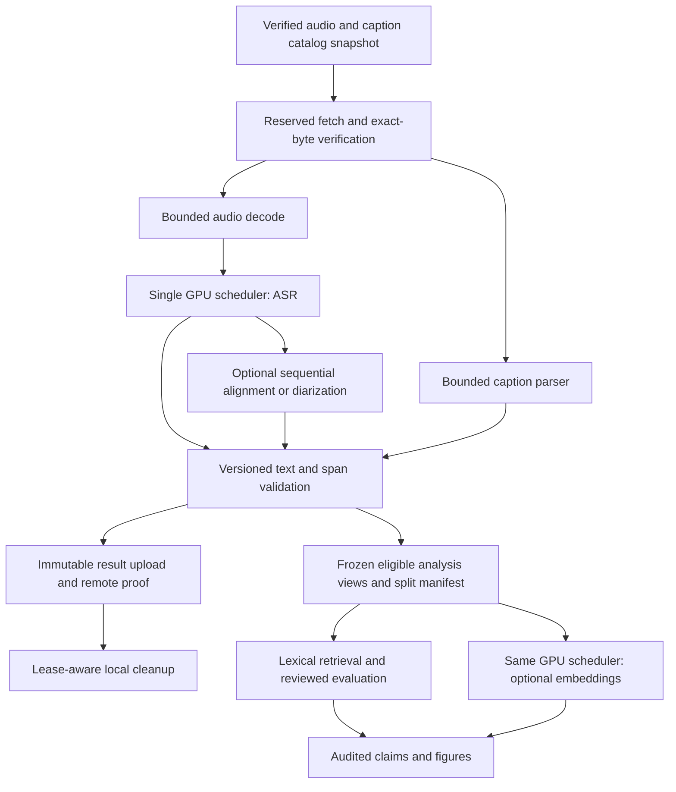

# Systems panel — round 3 independent review

Date: 2026-11-16. Reviewed [analysis round 2](analysis-panel-round2.md), [transcription round 2](transcription-panel-round2.md), the E0 contract in [analysis round 1](analysis-panel-round1.md), and the current storage/cleanup/transcription code. This is a design review: **no ASR, model installation/download, inference, runtime restart, or external data transfer was performed.** No new web searches were necessary; versioned primary-source evidence remains in transcription round 2. Repository inspection and the document whitespace check are the only verification performed in this round.

The plan is suitable for implementation design, but concurrent production transcription is not ready to enable. The most consequential gaps are a shared storage authority, leases honored by the actual deletion path, and a bounded reader for verified caption/audio artifacts. These are specific integration gaps, not evidence that current collection fails its existing single-run contract.

## 1. Prioritized findings and decisions

| Priority | Finding and evidence | Required change / decision | Owner |
| --- | --- | --- | --- |
| P0 — before concurrent ASR | `drive_ingest.Budget` uses an in-process `threading.RLock`, active reservations and cached usage explicitly intended for an exclusively owned run. A second ASR process with its own budget can spend the same remaining bytes. `exclusive_lock` protects ingestion runs, not an independently launched legacy transcriber. | One coordinator must own reservations and every writer/deleter, with worker requests over IPC; alternatively implement a transactional shared reservation store under an interprocess lock. Until that exists, serialize ingestion and ASR under the same ownership lock. Do not add a second nominal 17 GB allowance. | Ingestion/compute owner |
| P0 — before reuse of live local audio | Legacy `transcribe.py` writes `common.hold_items` notes, but current `drive_ingest.verify_and_delete` checks remote proofs and then removes local files without consulting those notes. The old transcriber also discovers jobs through local folders rather than the new immutable catalog. | Use exact artifact leases honored by **every** deletion path, or fetch an independently reserved ASR cache copy from verified Drive storage. A lease identifies artifact hash, run UUID and process generation; PID alone is insufficient. Recovery must distinguish a dead owner from a reused PID. | Ingestion/compute owner |
| P0 — before provisioning | The 17 GB private cap is an admission ceiling, not space already reserved for additional environments/models. Python installers, model hubs, Xet, temporary decoding, and index construction can otherwise write outside that tree. | Reaudit project bytes; place the environment and all model/download/build/temp caches inside accounted roots. Set explicit cache/temp paths and test them. Preserve `private_cap = min(17e9, 18e9 − outside_project_bytes − external_reservations)` and the physical-drive free-space floor. Count peak staging/rename copies and unfinished results. | Compute owner |
| P0 — before consuming caption bundles | The analysis adapter's safe ZIP/receipt checks are a contract, not an implemented reader. A correct archive SHA-256 proves the expected ZIP bytes, not safe extraction, valid text or truthful provenance. | Implement bounded member streaming and schema checks before any text becomes eligible. Reject corrupt, ambiguous or mismatched bundles; preserve the source and record a safe failure reason. Detailed cases are below. | Corpus engineering |
| P1 — before GPU pilot | RTX 4070 Laptop has 8,188 MiB VRAM. Current dependency pins are source-supported candidates; DLL loading, installed size, model fit and throttled speed remain unmeasured. Legacy defaults include automatic device choice and batch 16. | Explicit CUDA, batch 1 first, exact resolved lock/hashes, one GPU owner and a measured control loop. A loading failure defers the job rather than silently using CPU. Existing download success does not validate ASR. | Compute owner |
| P1 — before performance claims | A rolling 70% target cannot guarantee every Windows GPU utilization sample is ≤70%. Kernel execution is not preempted by application idle scheduling. | Report the rolling target and observed exceedances; pause new batches when telemetry is missing, another workload consumes headroom, or sustained load/temperature requires it. Do not describe power limits or a 6 GiB admission threshold as hard utilization/memory partitions. | Compute owner |
| P1 — before text selection | “One primary text per work” can silently lose speech if a preferred caption track covers only part of a recording. Caption storage verification is separate from coverage/quality. | Freeze a coverage-aware full-recording or interval-composite policy before outcomes. Each selected interval names its original version/span; gaps remain gaps. Keep published captions, original automatic captions and ASR as distinct versions, with paired views for calibration. | Corpus/evaluation owners |
| P1 — before evaluation | Gold 6 development + 18 held-out excerpts is a small ASR calibration/quality comparison, not the 80-work extraction probability sample or a powered population study. | Nest it within the E0 split manifest, preserve independent evaluation purposes and audit leakage groups/person/time boundaries. Report uncertainty and unsupported cells; do not turn 100 name mentions into 100 independent observations. | Evaluation owner |
| P1 — before public outputs | Artifact IDs, speaker labels, text and diagnostic logs have different disclosure requirements. Speaker clustering is not identity adjudication. | Keep raw artifacts, private Drive identifiers, evidence text, signed URLs and credentials out of public dashboards/logs. Export allowlisted aggregates and reviewed public links only. Treat imported text as data, never instructions for tools. | Corpus/research lead |

Source anchors: [current budget and cleanup implementation](../../pipeline/drive_ingest.py), [legacy transcription adapter](../../pipeline/transcribe.py), [legacy holds](../../pipeline/common.py). This review does not change their current collection behavior.

## 2. Accepted corrections from the earlier rounds

- The hardware is an **8 GB** laptop GPU. The 16 GB assumption is rejected. CPU decoding, hashing, parsing and I/O remain necessary; costly model inference should use CUDA as requested.
- The current CTranslate2 4.9.0 Windows source build disables cuDNN convolution. This resolves the documentation conflict at source level; it does not prove the actual wheel's DLL loading or local inference. Preserve tagged build evidence and test the proposed exact environment later. No NeMo/PyTorch/alignment stack is needed for the first candidate.
- Stored weights and compressed wheel sizes are metadata observations. The 4 GB environment and other allocation figures are conservative planning reservations, not measured installations. Runtime INT8 does not halve the FP16 model cache.
- The first comparison remains pinned distilled Whisper versus large-v3 in separate runs. Parakeet, alignment and diarization are conditional later candidates. No local speed, WER, name accuracy or hours/day has been measured.
- Use immutable catalog snapshots and exact artifact receipts rather than local filename scans or broad Drive listings. The native audio/metadata pair and English caption bundles are separate artifacts. Caption access blocks/empty text remain pending or unavailable with explicit reasons, not proof that no speech exists.
- Anonymous diarization labels are local to a recording. Channel owner, host, guest, asserted speaker and attributed entity remain separate fields with separate evidence.
- Clarify the round-2 shorthand: `recording_id` identifies one recording, while `leakage_group_id` joins confirmed duplicate/copy/excerpt relationships for split protection. `excerpt_of` is directed provenance, not an equivalence assertion that every excerpt is the same full recording. A reviewed grouping/version policy is required before IDs are frozen.

## 3. Bounded artifact lifecycle

### Receipt and ZIP admission

Read the immutable catalog manifest and its referenced checksummed objects first. A receipt provides expected identity, byte length and hashes. Fetch the exact Drive object into a budgeted `.part`; verify complete length and SHA-256 before promoting it to a reusable local artifact. Drive MD5/object ID remain useful remote proof, but neither permits skipping the expected local SHA-256 check. If the object changes after catalog capture, retain an explicit mismatch and refresh provenance through the catalog workflow; never silently accept replacement bytes under the old derivation ID.

For a caption ZIP, avoid `extractall`. Stream the exact allowed raw-caption, `segments.json`, `transcript.txt` and `provenance.json` members, with per-member and total **actual** decompressed-byte limits. Central-directory lengths are useful preflight values but cannot be the sole bound. Reject duplicate names, including Windows case/path normalization collisions; traversal/absolute/drive/UNC paths; alternate data streams; links; encrypted or unsupported members; truncated/CRC-invalid content; and excessive member count or declared/observed expansion. Bound JSON/string/event complexity as well as bytes. These checks can use offline malicious and corrupt fixtures without any source requests.

Cross-check every identity/language/kind/hash field that is actually present against the catalog and acquisition provenance. Raw JSON3/VTT often does **not** independently identify the video or language. Do not claim an independent cross-check of an absent field: the trusted acquisition receipt/provenance supplies that association. Require the current English-original policy and reject machine-translated provenance. Map catalog `ext` versus bundle `raw_format` explicitly by schema version; a missing projection field is not permission to guess the raw format.

A valid stored caption can still be incomplete, duplicated by rolling cues, or inaccurate. Preserve raw cues and bytes; a cleanup/parser change creates a new derivation with offset mappings. Empty usable text cannot become a successful text version. Nullable timings remain null where the source does not support reliable boundaries.

### Shared reservations, leases and durable cleanup

Reserve source download, bounded decoded windows, output, packaging and temporary duplication before admission. The current whole-audio float32 decode path consumes about 230.4 MB per audio hour before copies; replace it with bounded windows and explicit global offsets. Long recordings remain eligible and resumable instead of being excluded by an arbitrary duration cutoff.

A durable job key includes source artifact SHA-256, model revision/weight hash, decoder/VAD/chunk configuration, parser/normalization revision and output schema. A completed video ID alone cannot identify a completed derivation. Repeating the exact key is idempotent; changing the key produces a new version and does not overwrite prior evidence.

The state sequence should make recovery explicit: reserved → fetching → verified source → processing/checkpointed → locally validated result → uploading → remotely verified result → released local bytes. Persist remote proof before local deletion. A crash at any transition either resumes the same verified artifact/checkpoint or leaves it pending; it never manufactures a completed text version. Do not delete the authoritative Drive audio after ASR.

Every cleanup operation checks leases and resolved path boundaries under the same coordination mechanism as reservation changes. A lapsed heartbeat alone should not cause deletion while the process can still be alive or a Windows handle remains open. Quarantine uncertain ownership until reconciled; an operator can inspect it without losing source data. Orphan reservations are reclaimed only through explicit recovery with recorded evidence.

## 4. Asynchronous dependencies and throughput

Parallelism should overlap bounded I/O with one neural-model owner, rather than instantiate several ASR copies on the 8 GB GPU. The following is the proposed dependency graph, not a currently running service:



Only locally validated immutable artifacts are eligible for dependent work; durable production promotion additionally waits for required remote proof. A scheduler should bound each pending stage by reserved bytes and audio duration, not only number of items. Preserve channel fairness and service for long recordings; batching by similar window lengths can reduce padding without changing corpus eligibility. Warm-model blocks may amortize loading, but alignment, ASR and embedding blocks share one GPU lease.

Steady throughput is limited by the slowest admitted stage and by shared Drive quotas. Measure fetch, decode, inference, optional postprocessing, validation and upload separately, along with end-to-end wall time and queue age. Estimate service rates only from the later throttled pilot. A 70% target reduces available duty time; no fixed multiplier converts an unthrottled author benchmark into laptop throughput.

Backpressure is endpoint-specific. A caption timed-text cooldown does not block analysis of already verified audio/text. Drive fetch/upload cooldowns stop new network admissions while existing bounded local processing may continue only within reserved output space. GPU OOM uses bounded smaller-batch retries and remains on CUDA; exhausted retries defer the job. Storage pressure pauses admission without reporting completion. Shutdown stops admissions, records checkpoints and releases only safely recoverable resources.

## 5. Gold calibration versus analysis E0

Use one versioned split manifest shared by all panels:

| Purpose | Proposed units | Relationship and limitation |
| --- | --- | --- |
| E0 development | 30 work families in analysis round 1 | Development rules/prompts/dictionaries only. The six five-minute ASR development excerpts come from six eligible families here. |
| E0 held-out measurement audit | Up to 120 distinct work families | The eighteen five-minute ASR held-out excerpts come from distinct eligible families here. All selected audio offsets and source hashes are frozen before candidate outputs are opened. |
| ASR gold comparison | 6 development + 18 held-out excerpts; 30 + 90 minutes | Small paired calibration study with full independent annotation/adjudication of the held-out audio. Not a corpus-wide error guarantee; rare hallucination and rare-name cells may have little support. |
| Extraction probability evaluation | Round-2 design: initial 80 work families, then sampled windows from the four detector strata | Separate task, sampling design and weights. It may reuse eligible held-out families under a preregistered policy, but ASR calibration counts do not substitute for its inclusion probabilities, missed-positive assessment or uncertainty. |

The shared split unit is the reviewed leakage group, created before chunking. An unseen guest appearing on a development host's channel can contaminate a person-held-out test. Mixed-speaker recordings require reviewed speaker boundaries or quarantine. Chronological tests need date intervals that lie fully on the intended side of the cutoff. Record which purpose each item serves; do not tune extraction or retrieval from held-out ASR errors and then reuse those same items as untouched evaluation.

The six/eighteen allocation does not automatically fill all accents, periods, genres, noise conditions and person/time holdouts. Freeze feasible strata and report empty or sparse cells. If selection is purposive for calibration, label it purposive; only claim design-weighted population estimates when a probability frame and actual inclusion probabilities exist. One hundred proper-name mentions within eighteen recordings are clustered mentions, not independent trials. Report family-level paired differences and uncertainty; show hallucination, numeric/negation, overlap and speech-coverage outcomes separately from WER.

If a later identity/duplicate review joins development and test material into one leakage group, flag that evaluation as contaminated and preregister a replacement evaluation. Do not silently rewrite the split or retain favorable old metrics. The stable IDs and immutable manifests make this discoverable.

## 6. Executable acceptance checklist — specified, not run

The items below are future test cases with concrete fixture/action/result requirements. The new coordinator/adapter test runner does not exist yet; no command is invented for it here. Each owner must implement these tests before enabling the relevant stage.

| Gate | Offline fixture or controlled action | Required observable result |
| --- | --- | --- |
| G0: no accidental enablement | Import new modules, run status/plan with model/network functions replaced by fail-on-call stubs; inspect launcher changes. | Zero model loads/downloads, no ASR child process, no cloud inference request. Collection behavior remains independent until an explicit ASR command is selected. |
| G1: shared budget | Two processes race reservations/writes near a small fixture cap, including partial writes, output ZIP staging, metadata and process termination. | Total actual plus outstanding admitted bytes never exceed the fixture ceiling; dead-owner recovery cannot reclaim a live writer's allocation. The 20 GB/2 GB buffer formula is evaluated from a fresh inventory. |
| G2: path/cache accounting | Redirect installer/model/temp paths into a temporary fixture root; test an attempted outside-root path, junction/link escape and duplicate model staging. | Escapes fail before writing; all admitted bytes appear in the shared inventory. Installation is deferred if a peak reservation cannot fit. No real installation is needed for the offline path tests. |
| G3: artifact identity | Exact-size wrong-hash source, short read, changed remote object, interrupted `.part`, forged complete receipt and a valid fixture. | Only the valid exact artifact is promoted. Missing/mismatched proof remains pending; no text version is registered and no source is deleted. |
| G4: ZIP/text reader | Valid JSON3/VTT bundle; header-only/empty text; bad CRC; path/case duplicate; traversal; huge expansion; unsupported/encrypted member; wrong provenance; missing raw identity field. | Bounded reads and no outside writes. Corrupt/empty/mismatched cases fail with safe classes. An absent raw identity field is documented as provenance-bound, not fabricated. Valid text retains cue/span mappings. |
| G5: leases and crash recovery | Pause a reader with an active lease while cleanup requests deletion; simulate dead owner and PID reuse; terminate after upload, proof journal and before unlink. | Live artifacts stay readable. Recovery reconciles ownership, verifies exact proof and performs at most one logical promotion; no earlier derivation is overwritten. |
| G6: dependency/GPU smoke, later authorized | Resolved hash lock, measured install/model bytes, DLL inspection, explicit CUDA tiny development input; simulated OOM/telemetry loss in controller tests. | CUDA kernels observed, supported compute type, no CPU fallback, one GPU owner. Controller pauses/decreases admission on missing telemetry/OOM; actual rolling utilization/VRAM/temperature are recorded. This is not executed now. |
| G7: offsets and versions | Audio windows with speech crossing a boundary, silence, overlap and an extremely long synthetic timeline; two identical derivations and one changed parser/model config. | No unbounded whole-recording allocation; stable global offsets and explicit gaps; same key is idempotent, changed key produces a new version. No invented word timestamps. |
| G8: split and selection audit | Development/test manifests with known repost, excerpt, held-out guest and ambiguous date examples; a preferred partial-caption example. | Leakage cases are rejected/quarantined; E0/calibration/extraction purposes stay distinct. Coverage policy does not silently drop uncaptioned speech. |
| G9: bounded pipeline/backpressure | Stub Drive quota, caption cooldown, full output buffer and GPU busy states; inject termination at every state transition. | Correct endpoint pauses, no request before its deadline, bounded pending bytes and retries, truthful pending reasons, resumable work and STOP response. |
| G10: measured candidate pilot, later authorized | Cold-load trial, three warm development repeats, frozen held-out comparison with two human references and adjudication. | Report actual timing, RTF, bytes, RAM/VRAM, rolling GPU distribution, WER/names/numbers/negation/hallucination/coverage/overlap and uncertainty. Critical failed strata remain visible. No unsupported corpus ETA or production promotion. |
| G11: publication/privacy | Fixture transcripts containing credentials, signed URLs, private paths/Drive IDs and instruction-like text; export allowlist and dependency graph audit. | No sensitive field appears publicly; source text cannot invoke tools or redirect uploads. Only approved aggregate/derived artifacts cross the publication boundary. |

Existing offline suites can be reused as lower-level baselines after implementation changes, but do **not** certify these new contracts. Example commands, **not executed in this review**:

```powershell
$EtPython = Join-Path $env:USERPROFILE 'et-channelers-tools/venv/Scripts/python.exe'
& $EtPython -m unittest discover -s et-channelers/pipeline/tests -p test_archive_catalog.py -v
& $EtPython -m unittest discover -s et-channelers/pipeline/tests -p test_youtube_captions.py -v
& $EtPython -m unittest discover -s et-channelers/pipeline/tests -p test_drive_ingest_captions.py -v
```

## 7. Deferred gates and ownership handoff

Accepted now: immutable version/provenance contracts, explicit English caption policy, the calibrated GPU target, serial candidate evaluation, a shared-budget design requirement, and the test specifications above. Deferred: selecting the interprocess implementation, measured installed/model footprint, DLL/CUDA validation, a functioning bounded artifact adapter, actual GPU throttling behavior, calibrated model quality and any production ASR or analysis launch.

The compute owner implements coordination, caches, decode windows and the GPU controller; corpus engineering implements the artifact reader/version catalog; evaluation owns the frozen references, sampling and error tolerances; identity reviewers adjudicate host/guest/entity links; the research lead chooses a narrow pilot after the implementation gates pass. The root's reported bounded collection recovery pilot is an ingestion result only. This review neither changes that runtime nor enables ASR, alignment, diarization or embeddings.
