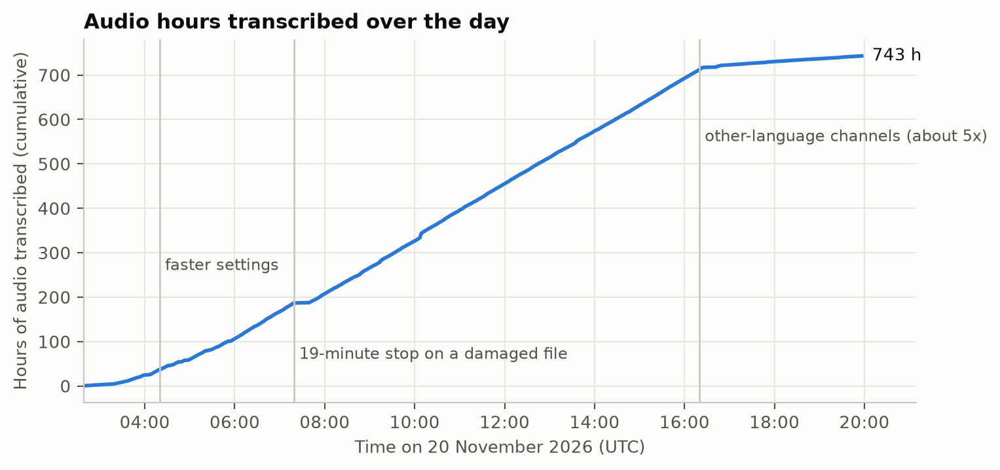
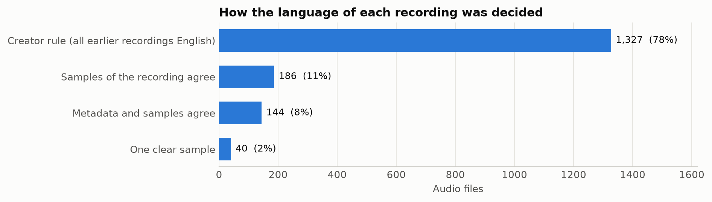
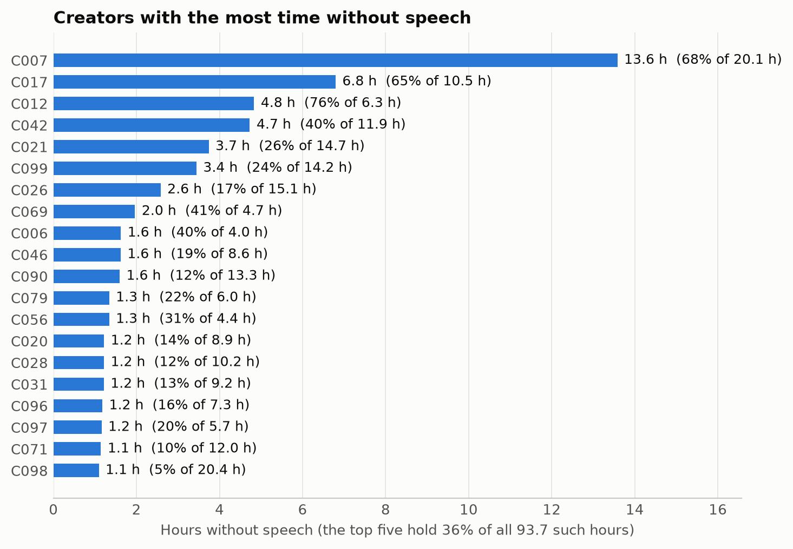
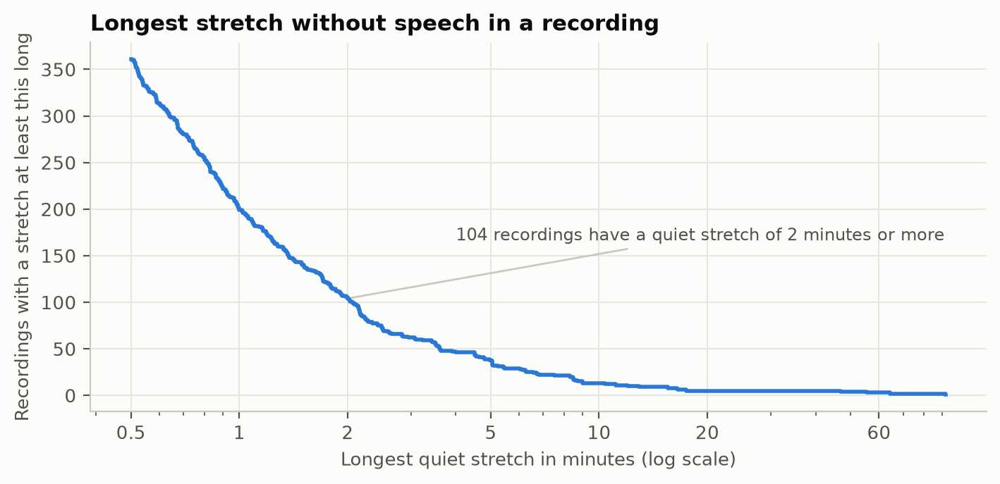
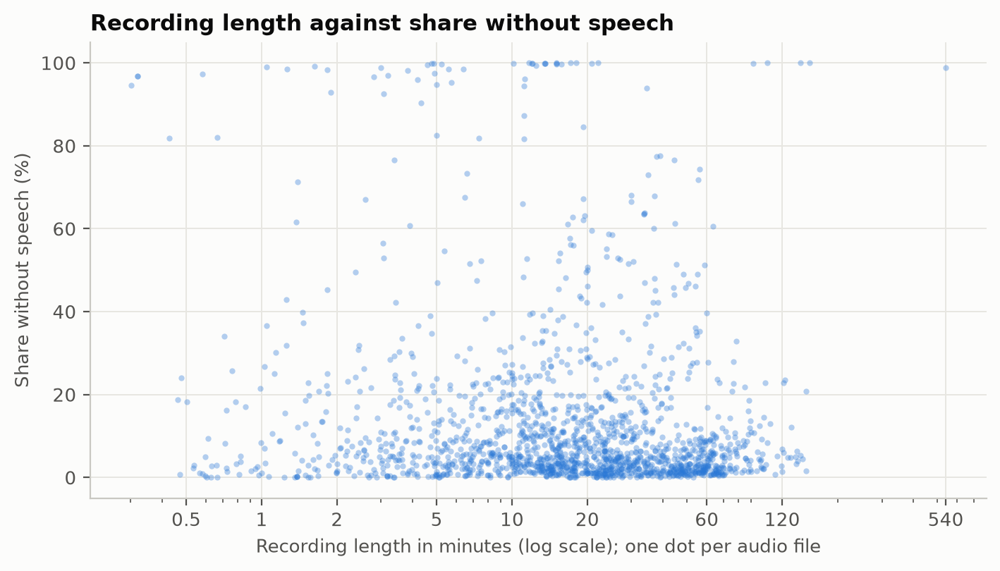
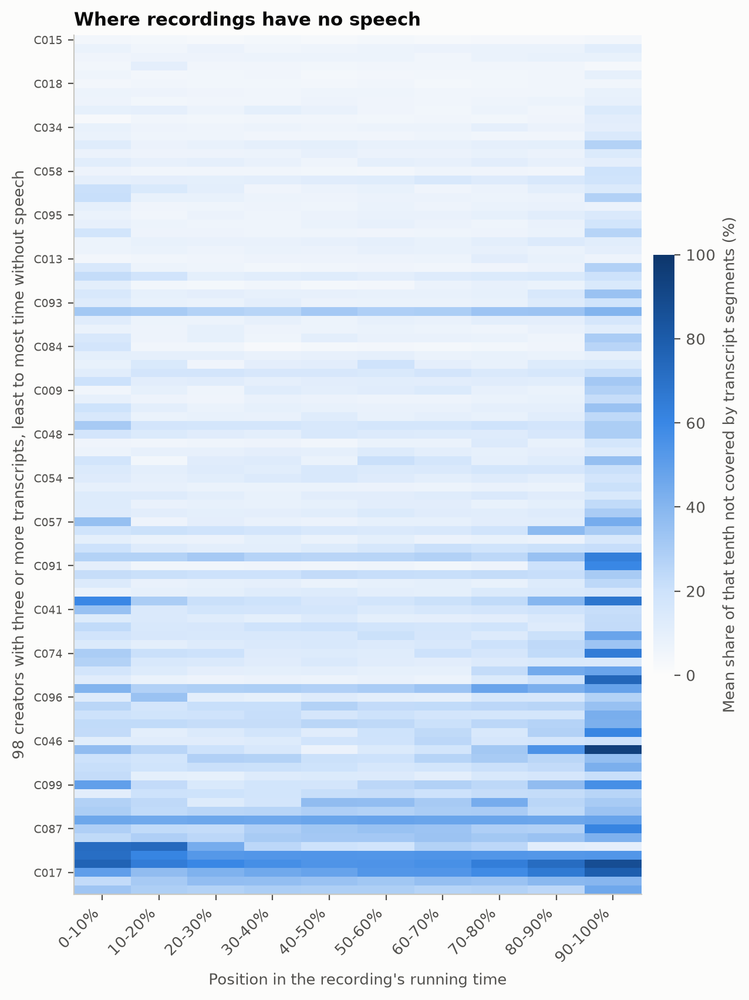
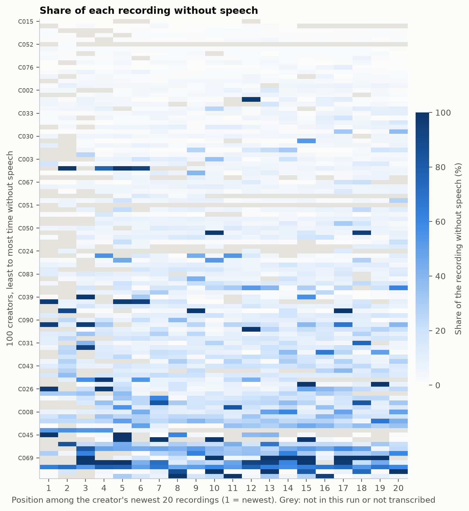
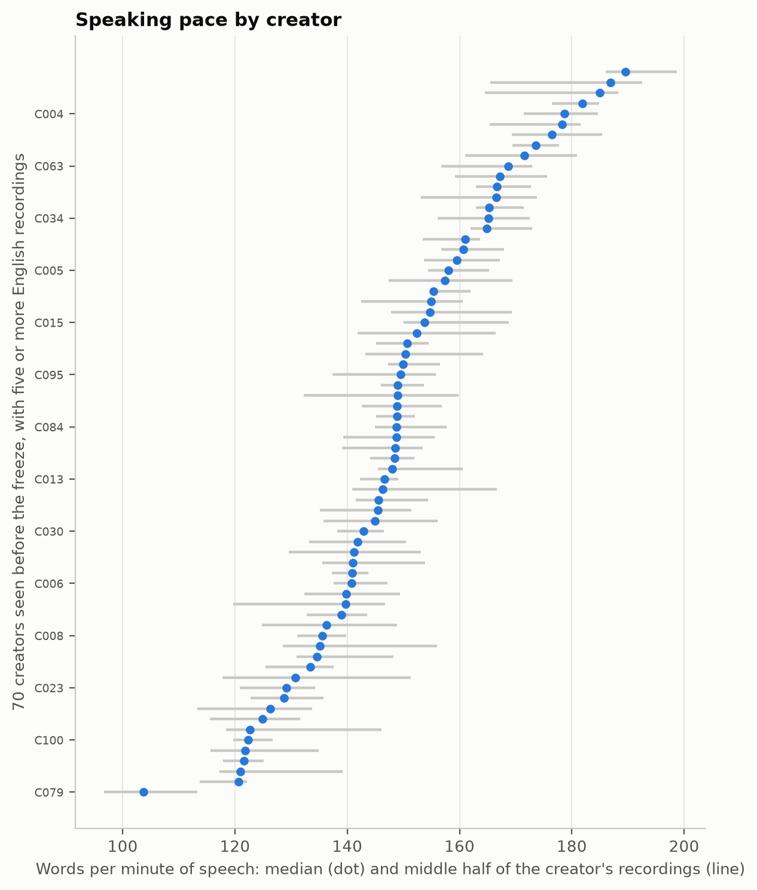

# Transcription run of 20 November 2026: plots, heat maps, graphs and tables

Finished run, 20 November 2026: 1,697 audio files, 742.9 hours. Everything here is a count or a measure of time; no transcript text is used. Creators appear
as coded ids (C001 to C101). The tables behind every figure are in [`tables/`](tables/).

Two notes on reading the numbers. "Without speech" is what the voice detector removed: music, meditation and
silence cannot be told apart. And the distributions count each audio file once: two files are each shared by two
recordings, so 1,697 audio files stand for 1,699 recordings.

## The run in numbers

| Measure | Value |
|---|---|
| Recordings selected | 1,976 |
| Recordings in the run | 1,731 |
| Audio files in the run | 1,729 |
| Audio files transcribed | 1,697 |
| Hours transcribed | 742.9 |
| Recordings not transcribed | 32 |
| Hours without speech | 93.7 |
| Share of hours without speech | 12.6% |
| Hours in quiet stretches of 30 s or more | 38.1 |
| Recordings with a quiet stretch of 2 minutes or more | 104 |
| Recordings at least half without speech | 107 |
| Median recording length, minutes | 17.8 |
| Median share without speech | 5.9% |
| Words transcribed | 5,832,446 |
| Recordings with a damaged packet passed over | 2 |

## What happened to the selected recordings

| Outcome | Recordings | Share |
|---|---|---|
| Transcribed in this run | 1,699 | 86.0% |
| Already had text of another kind | 215 | 10.9% |
| No speech found in the whole recording | 19 | 1.0% |
| Two languages both plausible | 7 | 0.4% |
| No clear speech in the samples | 4 | 0.2% |
| Failed the word-alignment check | 2 | 0.1% |
| Audio could not be downloaded | 30 | 1.5% |

The recordings that were not transcribed are listed, with the reason for each, in
[`tables/not-transcribed.csv`](tables/not-transcribed.csv).

## Languages

| Language | Audio files | Hours | Creators | Hours without speech |
|---|---|---|---|---|
| English | 1616 | 716.5 | 95 | 90.3 |
| Japanese | 30 | 11.4 | 2 | 1.0 |
| Spanish | 19 | 2.4 | 1 | 0.0 |
| Portuguese | 18 | 9.2 | 1 | 1.2 |
| German | 8 | 2.5 | 1 | 0.8 |
| Czech | 5 | 0.9 | 1 | 0.3 |
| Finnish | 1 | 0.1 | 1 | 0.1 |

How the language of each recording was decided:

| Basis | Audio files |
|---|---|
| Creator rule (all earlier recordings English) | 1,327 |
| Samples of the recording agree | 186 |
| Metadata and samples agree | 144 |
| One clear sample | 40 |

## Music, meditation and silence

93.7 of 742.9 hours (12.6%) hold no speech.
38.1 of those hours are in stretches of 30 seconds or more, and
104 recordings have a stretch of two minutes or more.
107 recordings are at least half without speech. The five creators with the most such time hold
36% of it.

### Heat maps

Where in a recording the speech is missing, for the 98 creators with three or more transcripts. Each
row is a creator and each column a tenth of the running time; darker means less of that tenth is covered by
transcript segments. Many creators are darker in the last tenth, and a few in the first.

The share without speech of each of a creator's newest 20 recordings. Grey cells are recordings that were not
in this run (they already had text of another kind, or their audio could not be downloaded) or were not
transcribed.

## Speaking pace

Words per minute of speech for the 70 creators that had already been looked at before the registry of
hypotheses was frozen and that have five or more English recordings. The hold-out creators are left out of
this figure on purpose: their transcripts are not analysed before the labelling procedure is frozen.

## Tables

| File | What it holds |
|---|---|
| [`tables/summary.csv`](tables/summary.csv) | the run in numbers |
| [`tables/outcome-of-selected-recordings.csv`](tables/outcome-of-selected-recordings.csv) | the 1,976 selected recordings by outcome |
| [`tables/languages.csv`](tables/languages.csv) | audio files, hours, creators and non-speech hours by language |
| [`tables/how-language-was-decided.csv`](tables/how-language-was-decided.csv) | audio files by the basis of the language decision |
| [`tables/not-transcribed.csv`](tables/not-transcribed.csv) | the recordings not transcribed, with minutes and reason |
| [`tables/per-creator.csv`](tables/per-creator.csv) | one row per coded creator: recordings, hours, non-speech hours and share, quiet stretches, languages, median pace where shown |

Made 2026-11-20 20:08 UTC from the run's ledger and result files. The figures follow one palette: a single blue
for marks, and a light-to-dark blue ramp for the heat maps.
