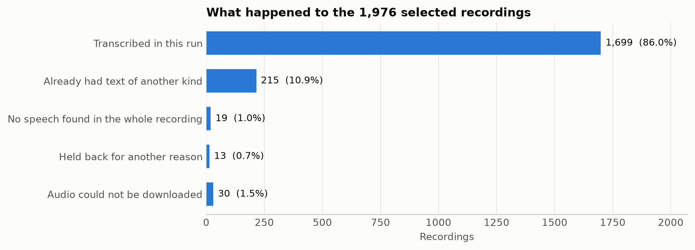
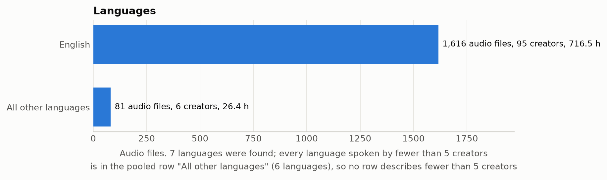
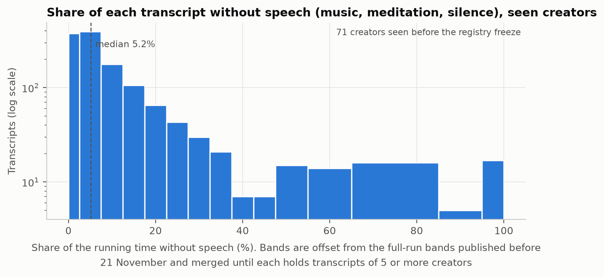
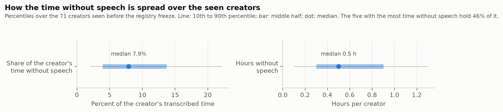
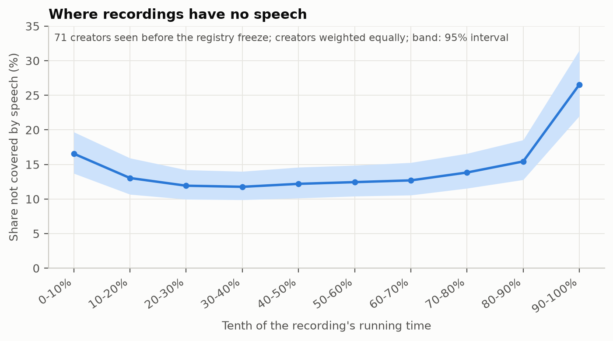
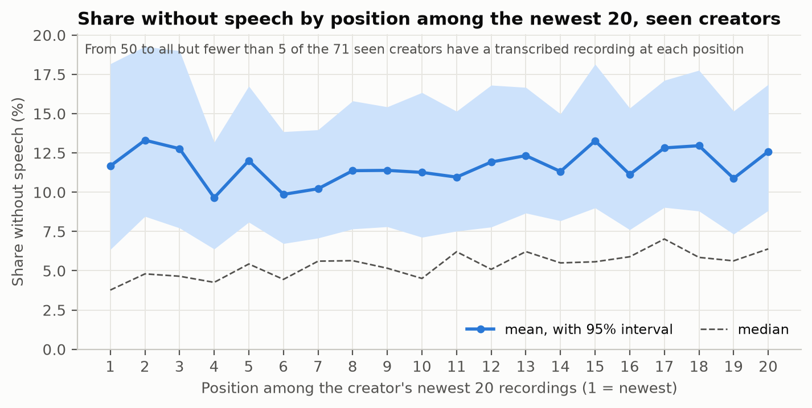

# Transcription run of 20 November 2026: plots, graphs and tables

Finished run, 20 November 2026: 1,697 audio files, 742.9 hours. Everything here is a count, a distribution or a cohort-level estimate; no transcript text is
used. Nothing is shown per creator or per recording: no creator codes, no video ids, no ranked lists, no table row,
chart mark or label for a single creator or recording. No row, bin or cell describes fewer than 5 creators; cells
with fewer than 5 creators are pooled. The tables behind every figure are in [`tables/`](tables/).

Where the numbers come from:

- **The whole run** (outcomes, recordings, hours, lengths, languages, how the language was decided): the run's ledger
  and its list of selected recordings, that is the creator, duration and language of each recording, never a
  transcript or a timing measure.
- **Timing measures** (time and share without speech, quiet stretches, speech by position in the recording, speaking
  pace): the 71 creators seen before the registry of hypotheses was frozen, only. The hold-out and other creators stay
  out of these displays until the labelling procedure is frozen (freeze 2). They count transcripts, one per audio file,
  except the newest-20 curve, which counts recordings.

## How small groups are kept out

- Every language spoken by fewer than 5 creators is in one pooled row, and so are the reasons for holding a
  recording back that concern fewer than 5 creators.
- Adjacent bands of every histogram are merged until each holds creators, recordings or transcripts of 5 or more
  creators; every cell of the two-dimensional table holds transcripts of 5 or more creators.
- The counts of transcripts with a quiet stretch "at least" so long are cumulative, so the band between two published
  thresholds, the band below the first and the tail past the last can each be found by subtraction: a threshold is
  shown only while every one of those bands holds transcripts of 5 or more creators.
- **Counts of creators of nested groups.** When two published counts of creators describe nested groups (one inside the other) and differ by 1 to 4, only one of them is printed as a number and the other is stated against it, as "all but fewer than 5 of N" for the smaller group or "N and fewer than 5 more" for the larger, so that no difference of the two is a group of fewer than 5 creators; no table or figure prints a total from which the withheld count follows. For example, the pace display rests on
  all but fewer than 5 of 71 seen creators (those with five or more English transcripts), and each position of the
  newest-20 curve that is held by all but fewer than 5 of the 71 seen creators is printed that way. The
  displays of recordings and hours transcribed per creator are over all 101 selected creators.
- The bands of share without speech and of the longest quiet stretch in the seen-creator displays are offset from the
  full-run bands that this report published before 21 November 2026 (share without speech: 2.5 points off the 5-point
  bands up to 50%, 5 points off the 10-point bands above; quiet stretches of 45 s, 90 s, 3 and 6 minutes against 30 s,
  1, 2, 5 and 10 minutes), so that no such band of the creators outside the seen group can be found by subtracting a
  seen count from an earlier full-run count. The length bands of the two-dimensional table are the full-run ones: a
  length band's earlier full-run count less its seen count gives the transcripts of the other creators in that band,
  and each such band holds transcripts of 5 or more creators.

"Without speech" is what the voice detector removed: music, meditation and silence cannot be told apart. The run in
numbers, the languages, how the language was decided and the length by language count audio files, as this report
did before 21 November 2026; the outcome table counts the selected recordings. Hours are of audio.

## The run in numbers

| Measure | Value |
|---|---|
| Creators selected | 101 |
| Recordings selected | 1,976 |
| Audio files in the run | 1,729 |
| Audio files transcribed | 1,697 |
| Hours transcribed | 742.9 |
| Recordings not transcribed | 32 |
| Median recording length, minutes | 17.8 |
| Languages found | 7 |
| Creators seen before the registry freeze | 71 |
| Share of hours without speech, seen creators | 12.1% |
| Share of the seen creators' hours without speech held by the five with the most | 46.0% |
| Share of hours in quiet stretches of 30 s or more, seen creators | 5.2% |
| Median share without speech of a seen transcript | 5.2% |

Cumulative hours of audio over the day, from the ledger and the times the result files were written. A point is shown
only where the rise since the previous one holds recordings of 5 or more creators
([`tables/hours-over-time.csv`](tables/hours-over-time.csv), 131 points; the findings page shows the
same points). The two marks are changes of the run: faster settings, and the other-language channels, which ran about
five times slower.

## What happened to the selected recordings

| Outcome | Recordings | Share |
|---|---|---|
| Transcribed in this run | 1,699 | 86.0% |
| Already had text of another kind | 215 | 10.9% |
| No speech found in the whole recording | 19 | 1.0% |
| Held back for another reason | 13 | 0.7% |
| Audio could not be downloaded | 30 | 1.5% |

The recordings that were not transcribed are counted by reason in the table above. Reasons that concern
recordings of fewer than 5 creators are counted together in the row "Held back for another reason"
(two languages both plausible, no clear speech in the samples, failed the word-alignment check). The list of those recordings is kept in the private archive.

## Languages

| Language | Audio files | Creators | Hours |
|---|---|---|---|
| English | 1,616 | 95 | 716.5 |
| All other languages | 81 | 6 | 26.4 |

7 languages were found. Every language other than English is spoken by fewer than 5 creators, so a
row of its own, even with counts only, would describe those creators; the 6 languages other than
English are therefore given only together, in the row "All other languages".

Recording length, in whole minutes, for English and for the other languages together (a percentile over the
recordings of fewer than 5 creators would be their own recordings' lengths):

How the language of each recording was decided:

| Basis | Audio files |
|---|---|
| Creator rule (all earlier recordings English) | 1,327 |
| Samples of the recording agree | 186 |
| Metadata and samples agree | 144 |
| One clear sample | 40 |

## Music, meditation and silence (seen creators)

Among the 71 creators seen before the registry freeze, 12.1% of the audio holds no
speech, and 5.2% lies in stretches of 30 seconds or more. The median
transcript is 5.2% without speech. The five seen creators with the most such time
hold 46% of it.

The longest stretch without speech is counted at 45 s or more, 90 s or more, 3 min or more and 6 min or more; a
longer threshold would leave a band of fewer than 5 creators.

Recording length against share without speech, in bins, for the seen creators' transcripts. Every bin holds
transcripts of 5 or more creators, so no bin is left out; the bands of
share without speech are unions of the bands of the histogram above.

### Where in a recording the speech is missing

The share of each tenth of the running time that is not covered by transcript segments, averaged over the
71 creators seen before the registry of hypotheses was frozen (each creator weighted equally), with
a 95% interval from resampling creators and then their transcripts. Speech is thinnest
at the ends: 17% of the first tenth and 27% of the last tenth are not covered, against about 12% in the
middle.

### The newest 20 recordings

The share without speech by position among each seen creator's newest 20 recordings (1 is the newest), as a mean
over the seen creators with a transcribed recording at that position (from 50 to
all but fewer than 5 of 71), with a 95% interval, and as a median.

## Speaking pace

Percentiles of the median words per minute of speech of the seen creators with five or more English transcripts
(all but fewer than 5 of 71 seen creators). Only percentiles are given: a histogram's total would print the number of
those creators. The hold-out creators are left out on purpose: their transcripts are not analysed before the labelling
procedure is frozen.

## Tables

| File | What it holds |
|---|---|
| [`tables/summary.csv`](tables/summary.csv) | the run in numbers; the timing rows are of the seen creators |
| [`tables/hours-over-time.csv`](tables/hours-over-time.csv) | cumulative hours of audio over the day; every rise between two points holds recordings of 5 or more creators |
| [`tables/outcome-of-selected-recordings.csv`](tables/outcome-of-selected-recordings.csv) | the 1,976 selected recordings by outcome; reasons of fewer than 5 creators pooled |
| [`tables/languages.csv`](tables/languages.csv) | audio files, creators and hours for English and for the other languages pooled (every language of fewer than 5 creators) |
| [`tables/how-language-was-decided.csv`](tables/how-language-was-decided.csv) | audio files by the basis of the language decision |
| [`tables/length-by-language.csv`](tables/length-by-language.csv) | percentiles of recording length, whole minutes, for English and for the other languages pooled |
| [`tables/recordings-histograms.csv`](tables/recordings-histograms.csv) | seen creators' transcripts per band of share without speech, and by longest quiet stretch (45 s or more, 90 s or more, 3 min or more, 6 min or more) |
| [`tables/length-by-share-bins.csv`](tables/length-by-share-bins.csv) | seen creators' transcripts per bin of length and share without speech; every bin holds transcripts of 5 or more creators |
| [`tables/creators-histograms.csv`](tables/creators-histograms.csv) | all 101 selected creators per band of recordings and of hours transcribed; adjacent bands merged until each holds 5 or more creators |
| [`tables/creators-quantiles.csv`](tables/creators-quantiles.csv) | the 10th, 25th, 50th, 75th and 90th percentiles over creators: recordings and hours (all selected creators), hours and share without speech and pace (seen creators) |
| [`tables/position-in-recording.csv`](tables/position-in-recording.csv) | share of each tenth of the running time not covered by speech, seen creators, with 95% interval |
| [`tables/newest-20-by-position.csv`](tables/newest-20-by-position.csv) | share without speech by position among the newest 20, seen creators, with 95% interval and quartiles |

Counts of the whole run come from the run's ledger and its list of selected recordings; the seen creators' timing
measures come from a copy of the run's per-recording measures that holds the seen creators only (made
2026-11-21 06:49:10 UTC). Tables and figures drawn 2026-11-21 08:04 UTC
under the rules above. The figures follow one palette: a single blue for marks, a light band for intervals and a
light-to-dark blue ramp for the binned plot.
