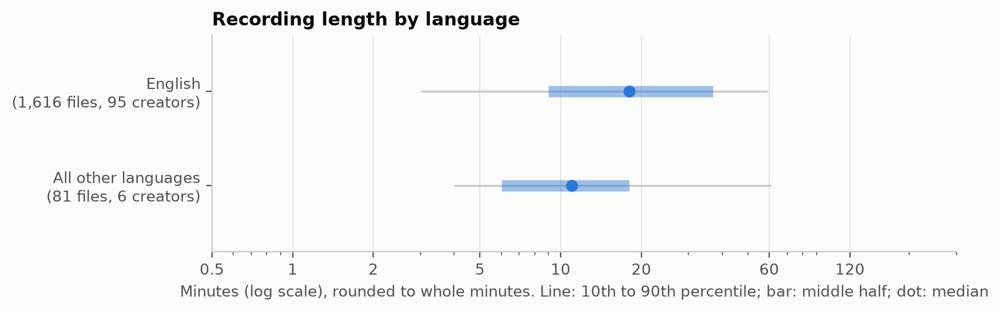
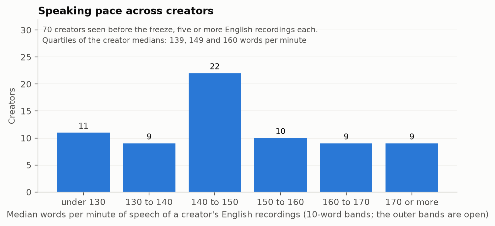

# Transcription run of 20 November 2026: plots, graphs and tables

Finished run, 20 November 2026: 1,697 audio files, 742.9 hours. Everything here is a count, a distribution or a cohort-level estimate; no transcript text is
used. Nothing is shown per creator or per recording: no creator codes, no video ids, no ranked lists, no table row,
chart mark or label for a single creator or recording. Every number the run measured rests on
5 or more creators: a language row shows hours and time without speech only if that many
creators speak the language, every bin of the two-dimensional table and of the histograms over audio files holds
files of that many creators, and the outer bands of the histograms over creators are merged until each holds that
many. The tables behind every figure are in [`tables/`](tables/).

Two notes on reading the numbers. "Without speech" is what the voice detector removed: music, meditation and
silence cannot be told apart. And the distributions count each audio file once: two files are each shared by two
recordings, so 1,697 audio files stand for 1,699 recordings.

## The run in numbers

| Measure | Value |
|---|---|
| Recordings selected | 1,976 |
| Recordings in the run | 1,731 |
| Audio files in the run | 1,729 |
| Audio files transcribed | 1,697 |
| Hours transcribed | 742.9 |
| Recordings not transcribed | 32 |
| Hours without speech | 93.7 |
| Share of hours without speech | 12.6% |
| Share of the hours without speech held by the five creators with the most | 35.9% |
| Hours in quiet stretches of 30 s or more | 38.1 |
| Recordings with a quiet stretch of 2 minutes or more | 104 |
| Recordings at least half without speech | 107 |
| Median recording length, minutes | 17.8 |
| Median share without speech | 5.9% |
| Words transcribed | 5,832,446 |
| Recordings with a damaged packet passed over | 2 |

## What happened to the selected recordings

| Outcome | Recordings | Share |
|---|---|---|
| Transcribed in this run | 1,699 | 86.0% |
| Already had text of another kind | 215 | 10.9% |
| No speech found in the whole recording | 19 | 1.0% |
| Two languages both plausible | 7 | 0.4% |
| No clear speech in the samples | 4 | 0.2% |
| Failed the word-alignment check | 2 | 0.1% |
| Audio could not be downloaded | 30 | 1.5% |

The recordings that were not transcribed are counted by reason in the table above. The list of those
recordings is kept in the private archive.

## Languages

| Language | Audio files | Creators | Hours | Hours without speech |
|---|---|---|---|---|
| English | 1,616 | 95 | 716.5 | 90.3 |
| Japanese | 30 | 2 |  |  |
| Spanish | 19 | 1 |  |  |
| Portuguese | 18 | 1 |  |  |
| German | 8 | 1 |  |  |
| Czech | 5 | 1 |  |  |
| Finnish | 1 | 1 |  |  |
| All other languages | 81 | 6 | 26.4 | 3.4 |

Every language other than English is spoken by one or two creators, so a row of its own would be those creators'
values. Those rows give counts only; their hours and time without speech are given together, in the row
"All other languages".

Recording length, in whole minutes, for English and for the other languages together (a percentile of one or two
creators' files would be their recordings' lengths):

How the language of each recording was decided:

| Basis | Audio files |
|---|---|
| Creator rule (all earlier recordings English) | 1,327 |
| Samples of the recording agree | 186 |
| Metadata and samples agree | 144 |
| One clear sample | 40 |

## Music, meditation and silence

93.7 of 742.9 hours (12.6%) hold no speech.
38.1 of those hours are in stretches of 30 seconds or more, and
104 recordings have a stretch of two minutes or more.
107 recordings are at least half without speech. The five creators with the most such time hold
36% of it.

Recording length against share without speech, in bins. The bands are wide enough that every bin holds files of
5 or more creators, so no bin is left out; the bands of
share without speech are unions of the bands of the histogram above.

### Where in a recording the speech is missing

The share of each tenth of the running time that is not covered by transcript segments, averaged over the
71 creators seen before the registry of hypotheses was frozen (1,293 audio files; each creator
weighted equally), with a 95% interval from resampling creators and then their recordings. Speech is thinnest
at the ends: 17% of the first tenth and 27% of the last tenth are not covered, against about 12% in the
middle. The hold-out and other creators are left out of this display until the labelling procedure is frozen.

### The newest 20 recordings

The share without speech by position among each creator's newest 20 recordings (1 is the newest), as a mean
over the 59 to 93 creators with a transcribed recording at that position, with a 95% interval, and
as a median.

## Speaking pace

The distribution of the median words per minute of speech of the 70 creators that had already been looked at before
the registry of hypotheses was frozen and that have five or more English recordings. The hold-out creators are
left out on purpose: their transcripts are not analysed before the labelling procedure is frozen.

## Tables

| File | What it holds |
|---|---|
| [`tables/summary.csv`](tables/summary.csv) | the run in numbers |
| [`tables/outcome-of-selected-recordings.csv`](tables/outcome-of-selected-recordings.csv) | the 1,976 selected recordings by outcome |
| [`tables/languages.csv`](tables/languages.csv) | audio files and creators by language; hours and non-speech hours where a row has 5 or more creators, and for the other languages pooled |
| [`tables/how-language-was-decided.csv`](tables/how-language-was-decided.csv) | audio files by the basis of the language decision |
| [`tables/length-by-language.csv`](tables/length-by-language.csv) | percentiles of recording length, whole minutes, for English and for the other languages pooled |
| [`tables/recordings-histograms.csv`](tables/recordings-histograms.csv) | audio files per band of share without speech (5-point bands to 50%, 10-point above), and by longest quiet stretch (30 s or more, 1 min or more, 2 min or more, 5 min or more, 10 min or more) |
| [`tables/length-by-share-bins.csv`](tables/length-by-share-bins.csv) | audio files per bin of length and share without speech; every bin holds files of 5 or more creators |
| [`tables/creators-histograms.csv`](tables/creators-histograms.csv) | creators per band of six measures (recordings, hours, hours and share without speech, median length, median pace); outer bands merged until each holds 5 or more creators |
| [`tables/creators-quantiles.csv`](tables/creators-quantiles.csv) | the 10th, 25th, 50th, 75th and 90th percentiles of the same measures over creators |
| [`tables/position-in-recording.csv`](tables/position-in-recording.csv) | share of each tenth of the running time not covered by speech, seen creators, with 95% interval |
| [`tables/newest-20-by-position.csv`](tables/newest-20-by-position.csv) | share without speech by position among the newest 20, with 95% interval and quartiles |

Made 2026-11-20 20:08 UTC from the run's ledger and result files; tables and figures redrawn on 20 November 2026
under the rule above. The figures follow one palette: a single blue for marks, a light band for intervals and a
light-to-dark blue ramp for the binned plot.
